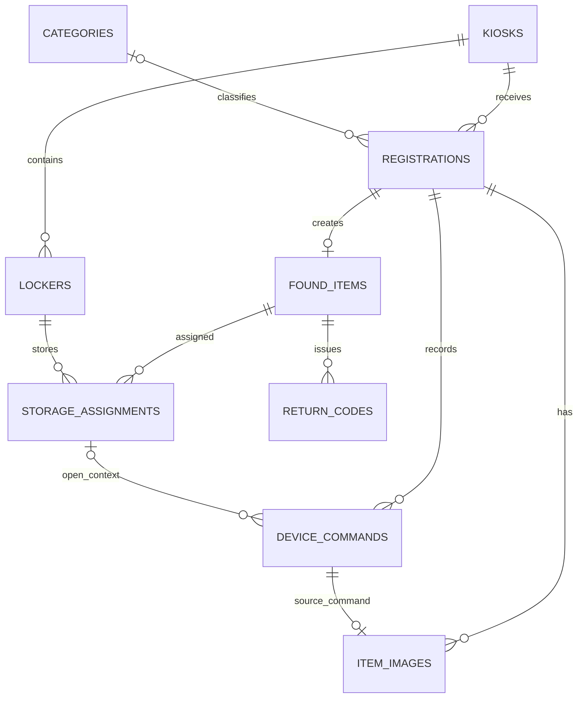

# 백엔드 ERD 명세

기준: `back_pickup-return-code` 작업 트리

[ORM 모델](../app/models.py)과 [마이그레이션 2개](../alembic/versions/)에 실제 존재하는 업무 테이블 9개를 정리한다. 소유 확인 실험의 Pydantic 모델은 DB 테이블이 아니며, 미구현 설계 후보는 6절에 따로 둔다.

동작은 [기능 명세](functional-spec.md), 요청·응답은 [개발용 API 계약](../../docs/api.md), 남은 협의는 [연동 협의](integration-agreements.md)에 있다.

## 1. 구현 범위

| 대상 | 현재 구현 |
| --- | --- |
| 등록·위치·카테고리 | `kiosks`, `categories`, `lockers`, `registrations` |
| 사진·장치 명령 | `item_images`, `device_commands` |
| 물건·보관 배정 | `found_items`, `storage_assignments` |
| AI 분석 결과 | `registrations.analysis_features` JSONB와 입력 사진 ID 스냅샷 |
| 장치 주소·키 | [Settings](../app/config.py)의 `PI_DEVICES` 설정. `devices` 테이블 없음 |
| 반환 코드·수령 | `return_codes`. 코드 평문은 저장하지 않고 SHA-256 해시만 보관 |
| 소유 확인 | 질문 생성 실험 코드만 존재. 질문·답변·판정 테이블 없음. **반환 코드 발급에 소유 확인 선행 조건이 없다** |

Alembic revision은 `0001_registration_storage` → `0002_pickup_return_code` 두 개다. `0002`는 세 테이블의 CHECK를 바꾸고 `return_codes`를 추가한다. SQLite는 CHECK를 제자리 변경하지 못하므로 batch 모드로 해당 테이블을 재작성한다. Alembic이 사용하는 `alembic_version`은 업무 테이블 9개에 포함하지 않는다.

## 2. 물리 관계도

- 사진의 등록 FK와 촬영 명령 FK는 모두 필수다. 명령 하나에 사진은 최대 1개다.
- 하나의 등록에서 물건은 최대 1개다. 등록만 있거나 촬영·분석 중인 동안은 물건이 없을 수 있다.
- 물건과 보관함에는 배정 이력을 여러 개 연결할 수 있으나, 각각 `ended_at IS NULL`인 배정은 최대 1개다.
- `storage_assignment_id`는 촬영 명령에서 NULL, 등록·수령 개방 명령에서 필수다. `registration_id`는 모든 명령에서 필수다. 수령 개방 명령도 해당 물건의 등록 ID를 사용한다.
- 물건 하나에 반환 코드 이력을 여러 개 연결할 수 있으나, `active` 또는 `opening`인 코드는 최대 1개다.
- 그림의 관계는 FK·UNIQUE를 표현한다. 사진과 명령의 등록 일치 같은 교차 조건은 5절의 서비스 책임과 구분한다.

## 3. 타입·기본값·공통 컬럼

타입은 PostgreSQL dialect 기준이다. `varchar`는 길이 제한 없는 `String()`, `float`는 `Float()`, `timestamptz`는 `DateTime(timezone=True)`를 뜻한다. 테스트용 SQLite에서는 UUID·JSON·시각 표현이 다르다.

`device_commands`를 제외한 7개 테이블은 아래 컬럼을 공통으로 가진다.

| 컬럼 | PostgreSQL 타입 | NULL | 제약·값 생성 |
| --- | --- | --- | --- |
| id | uuid | 불가 | PK. ORM 기본값 `uuid4()` |
| created_at | timestamptz | 불가 | ORM 기본값 UTC `now()` |

모든 테이블에 DB 서버 기본값(`server_default`)은 없다. 표의 기본값은 SQLAlchemy를 거치는 INSERT에만 적용되는 Python 기본값이므로, 직접 SQL로 삽입할 때 UUID·시각·상태가 자동 생성된다고 가정하면 안 된다.

FK에 `ON DELETE CASCADE`나 `ON UPDATE` 정책을 별도로 선언하지 않았다. 공통 `updated_at`, 삭제 시각, 사용자 FK는 없다. API의 입력 길이 제한과 DB 제약은 별도이며 아래 표에서 구분한다.

## 4. 테이블 정의

### 4.1 kiosks

| 컬럼 | 타입 | NULL | 제약·의미 |
| --- | --- | --- | --- |
| name | varchar(200) | 불가 | 표시 이름 |
| location_description | varchar | 허용 | 설치 장소 설명 |
| latitude | float | 허용 | 위도 |
| longitude | float | 허용 | 경도 |

공통 `id`, `created_at` 포함. CHECK는 `coordinates_pair`: 두 좌표가 함께 NULL이거나 함께 값이 존재, `latitude_range`: -90~90, `longitude_range`: -180~180이다. 위치·이름 관리 API는 없다.

### 4.2 categories

| 컬럼 | 타입 | NULL | 제약·의미 |
| --- | --- | --- | --- |
| code | varchar(100) | 불가 | UNIQUE, 카테고리 코드 |
| name | varchar(200) | 불가 | 표시 이름 |

공통 `id`, `created_at` 포함. 확정 카테고리 목록·계층·부모 FK는 없다. 로컬 시드도 카테고리를 생성하지 않는다.

### 4.3 lockers

| 컬럼 | 타입 | NULL | 제약·의미 |
| --- | --- | --- | --- |
| kiosk_id | uuid | 불가 | FK → `kiosks.id` |
| locker_number | integer | 불가 | 키오스크 안의 칸 번호 |

공통 `id`, `created_at` 포함. `UNIQUE(kiosk_id, locker_number)`, CHECK `positive_locker_number`: `locker_number > 0`이다. 칸 수를 2개로 제한하는 DB 제약은 없다. 로컬 시드가 개발용 1·2번 칸을 생성한다.

Pi 경로에는 내부 UUID가 아닌 `locker_number`를 전달한다. 문 상태나 점유 상태 컬럼은 없으며, 점유는 유효 배정으로 판단한다.

### 4.4 registrations

| 컬럼 | 타입 | NULL | 제약·의미 |
| --- | --- | --- | --- |
| kiosk_id | uuid | 불가 | FK → `kiosks.id` |
| primary_category_id | uuid | 허용 | FK → `categories.id`, 현재 API 선택 입력 |
| secondary_description | varchar | 허용 | 사용자 자유 특징. API 최대 2,000자, DB 길이 CHECK 없음 |
| status | varchar | 불가 | ORM 기본값 `draft` |
| analysis_status | varchar | 불가 | ORM 기본값 `pending` |
| analysis_input_image_ids | jsonb | 허용 | 분석 시작 시 저장하는 순서 있는 사진 UUID 문자열 목록 |
| analysis_features | jsonb | 허용 | 분석 성공 시 저장하는 특징 딕셔너리 |

공통 `id`, `created_at` 포함.

- CHECK `registration_status`: `draft / capturing / analyzing / ready / opening / awaiting_deposit / stored / blocked`.
- CHECK `analysis_status`: `pending / running / succeeded / failed`.
- JSONB 내부 키·타입·사진 FK·목록 길이에 대한 DB CHECK는 없다. 성공 조건은 서비스에서 검사한다.
- `analysis_features`는 `secondary_description`과 별도로 저장한다. 색상·브랜드·신뢰도 등을 필수 DB 필드로 고정하지 않는다.
- 분석 실패 시 서비스는 `analysis_features=None`으로 비우고 사진 ID 스냅샷은 유지한다. JSON 컬럼의 SQL NULL과 JSON null을 구분하는 별도 정책은 없다.

### 4.5 found_items

| 컬럼 | 타입 | NULL | 제약·의미 |
| --- | --- | --- | --- |
| registration_id | uuid | 불가 | FK → `registrations.id`, UNIQUE |
| status | varchar | 불가 | ORM 기본값 `awaiting_deposit` |

공통 `id`, `created_at` 포함. CHECK `item_status`는 `awaiting_deposit / stored / retrieved`를 허용한다.

개방 서비스가 빈 칸을 확보한 뒤, 외부 개방 요청을 보내기 전에 물건·배정·명령을 저장한다. 따라서 행이 존재하거나 `awaiting_deposit`라고 해서 실제 문이 열렸거나 물건이 투입됐다는 뜻은 아니다. 개방 실패 시에도 행을 유지한다.

수령 개방 중에도 물건은 `stored`를 유지한다. 물건은 아직 보관함 안에 있고, 검색에서 제외하는 일은 배정 상태가 담당한다. `retrieved`는 사용자 확인과 문 `closed`를 모두 확인한 뒤에 기록하며, 물건을 실제로 꺼냈는지를 뜻하지 않는다. 문 센서는 개폐만 알리므로 물건을 두고 문만 닫아도 같은 결과가 된다.

### 4.6 storage_assignments

| 컬럼 | 타입 | NULL | 제약·의미 |
| --- | --- | --- | --- |
| found_item_id | uuid | 불가 | FK → `found_items.id` |
| locker_id | uuid | 불가 | FK → `lockers.id` |
| status | varchar | 불가 | ORM 기본값 `reserved` |
| deposited_at | timestamptz | 허용 | 최초 투입 완료 확정 시각 |
| ended_at | timestamptz | 허용 | NULL이면 유효 배정 |

공통 `id`, `created_at` 포함.

| 제약 | 구현 |
| --- | --- |
| `assignment_status` CHECK | `reserved / awaiting_deposit / stored / awaiting_pickup / retrieved / cancelled` |
| `assignment_end` CHECK | `(status IN ('cancelled','retrieved')) = (ended_at IS NOT NULL)` |
| `uq_active_locker` | `locker_id` UNIQUE, 조건 `ended_at IS NULL` |
| `uq_active_item` | `found_item_id` UNIQUE, 조건 `ended_at IS NULL` |

두 부분 UNIQUE 인덱스는 PostgreSQL·SQLite 모두 선언돼 있다. DB는 `cancelled`·`retrieved`이면 종료 시각이 있고 다른 상태면 종료 시각이 없도록 강제한다.

수령 완료가 배정을 종료하는 유일한 경로다. `ended_at`을 채우면 두 부분 UNIQUE 인덱스의 조건에서 빠지므로 해당 칸과 물건이 즉시 재배정 가능해진다. 보관 완료(`stored`) 상태에서는 `ended_at=NULL`로 점유를 유지한다. `cancelled`는 DB 허용값만 있고 실행 경로가 없다. `retrieved_at` 전용 컬럼, 시각 선후 관계 CHECK, 배정 종료를 되돌리는 복구 경로는 없다.

### 4.7 device_commands

이 테이블은 공통 `id`를 사용하지 않는다.

| 컬럼 | 타입 | NULL | 제약·의미 |
| --- | --- | --- | --- |
| command_id | varchar | 불가 | PK. ORM 기본값 UUID 문자열, 서비스에서도 UUID 문자열 발급 |
| registration_id | uuid | 불가 | FK → `registrations.id` |
| action | varchar | 불가 | `capture`, `open`(등록) 또는 `pickup_open`(수령), 아래 CHECK로 제한 |
| shot_order | integer | 허용 | 촬영 순서 1 또는 2 |
| storage_assignment_id | uuid | 허용 | FK → `storage_assignments.id` |
| expires_at | timestamptz | 불가 | 명령 유효 기한, 서비스가 설정 TTL로 계산 |
| created_at | timestamptz | 불가 | ORM 기본값 UTC `now()` |
| status | varchar | 불가 | ORM 기본값 `sent` |
| error_code | varchar | 허용 | 처리한 연동 오류 코드 |

- CHECK `command_status`: `sent / succeeded / failed / unknown`.
- CHECK `command_target`: 촬영이면 `shot_order IN (1,2)` 및 NOT NULL, 배정 FK는 NULL. `open`·`pickup_open`이면 촬영 순서는 NULL, 배정 FK는 NOT NULL.
- `UNIQUE(registration_id, shot_order)`: 등록의 각 촬영 순서에 명령은 최대 1개다. 실패한 촬영을 새 명령으로 재시도하는 구조는 없다.
- 개방 명령의 `shot_order`는 NULL이므로 이 UNIQUE가 등록당 개방 명령을 1개로 제한하지는 않는다. 같은 등록에 `open` 1건과 `pickup_open` 1건 이상이 공존한다. 중복 개방 억제는 서비스의 상태 전이·기존 결과 재사용 책임이다.
- 장치 FK·직접 보관함 FK·반환 코드 FK·응답 본문·완료 시각 컬럼은 없다. 대상 칸은 배정을 통해 찾는다. 문 조회는 명령 행을 만들지 않는다.

### 4.8 item_images

| 컬럼 | 타입 | NULL | 제약·의미 |
| --- | --- | --- | --- |
| registration_id | uuid | 불가 | FK → `registrations.id` |
| capture_command_id | varchar | 불가 | FK → `device_commands.command_id`, UNIQUE |
| shot_order | integer | 불가 | 촬영 순서 |
| object_key | varchar | 불가 | UNIQUE, S3 객체 키 |
| content_type | varchar | 불가 | ORM 기본값 `image/jpeg` |
| byte_size | integer | 불가 | 저장하는 JPEG 바이트 수 |
| received_at | timestamptz | 불가 | ORM 기본값 UTC `now()`; 촬영 서비스는 JPEG 수신·검증 후 시각을 전달 |

공통 `id`, `created_at` 포함.

- `UNIQUE(registration_id, shot_order)`.
- CHECK `image_order`: `shot_order IN (1,2)`.
- CHECK `image_size`: `byte_size > 0`.
- CHECK `image_type`: `content_type = 'image/jpeg'`.
- 사진 행은 JPEG 검증과 객체 저장이 성공한 뒤 INSERT한다. `storage_status`나 저장 대기 행은 없으며 `object_key`·`byte_size`·`received_at`은 모두 NOT NULL이다.
- 객체 키 형식은 `registrations/{registration_id}/{command_id}.jpg`. 버킷은 설정에서 관리한다. 사진 바이트·서명 URL·실제 카메라 촬영 시각은 DB에 저장하지 않는다.

### 4.9 return_codes

| 컬럼 | 타입 | NULL | 제약·의미 |
| --- | --- | --- | --- |
| found_item_id | uuid | 불가 | FK → `found_items.id` |
| code_hash | varchar(64) | 불가 | UNIQUE, 정규화한 코드의 SHA-256 16진 문자열 |
| status | varchar | 불가 | ORM 기본값 `active` |
| expires_at | timestamptz | 불가 | 서비스가 `RETURN_CODE_TTL_SECONDS`로 계산 |
| used_at | timestamptz | 허용 | 개방 성공으로 사용 처리한 시각 |
| failed_attempts | integer | 불가 | ORM 기본값 0. 명확한 개방 실패 횟수 |

공통 `id`, `created_at` 포함.

| 제약 | 구현 |
| --- | --- |
| `return_code_status` CHECK | `active / opening / used / locked / revoked` |
| `return_code_use` CHECK | `(status = 'used') = (used_at IS NOT NULL)` |
| `return_code_attempts` CHECK | `failed_attempts >= 0` |
| `uq_open_return_code` | `found_item_id` UNIQUE, 조건 `status IN ('active','opening')` |

- 코드 평문을 저장하는 컬럼이 없다. 발급 응답에서 한 번만 전달하며 DB·로그 어디에도 남기지 않는다. 조회는 입력값을 같은 방식으로 정규화·해싱해 `code_hash`로 찾는다. 정규화는 공백·하이픈 제거와 대문자 변환이다.
- 코드는 `secrets`의 5바이트를 패딩 없는 base32 8자로 표현한다. 길이·문자 집합·TTL은 현재 구현 선택이며 합의된 정책이 아니다.
- `opening`은 개방 명령을 보내기 전에 조건부 UPDATE로 선점한 상태다. 부분 UNIQUE 인덱스가 `active`와 함께 이 상태도 덮으므로, 재발급이 진행 중인 코드를 덮어쓰지 못한다.
- `locked`는 개방 결과를 알 수 없을 때(`unknown`) 기록한다. 문이 이미 열렸을 수 있어 같은 코드의 재개방을 막으며, 해소하는 서비스·API는 없다.
- `revoked`는 재발급이 이전 코드를 무효화한 상태다. 만료는 상태를 바꾸지 않고 `expires_at` 비교로 판단하므로, 만료된 코드도 `active`로 남아 있을 수 있다.
- 대상 키오스크 컬럼은 없다. 코드 → 물건 → 유효 배정 → 칸 → 키오스크로 찾아 요청의 키오스크와 대조한다.
- 발급 요청자·승인 근거·질문/답변 FK·시도 제한 상한·재발급 횟수 컬럼은 없다. `failed_attempts`는 기록용이며 이 값으로 코드를 차단하지 않는다.

## 5. DB 제약과 서비스 보장의 경계

| 규칙 | 실제 보장 위치 | 제한 |
| --- | --- | --- |
| 사진 순서당 1장, 촬영 명령당 1장 | DB UNIQUE·CHECK | 1장→2장 순서 및 두 장 준비 여부는 서비스 검사 |
| 사진과 명령이 같은 등록을 가리킴 | 촬영 서비스가 동일 등록 ID로 작성 | 두 독립 FK만으로 교차 일치를 강제하지 않음 |
| 분석이 현재 사진 두 장에 대응 | 분석 결과 ID·순서 검사, 개방 전 스냅샷 재검사 | JSON 내부 FK·특징 의미 검증 없음 |
| 같은 칸·물건에 유효 배정 최대 1개 | 부분 UNIQUE 인덱스 | 등록 키오스크와 배정 칸 키오스크 일치는 서비스가 선택으로 보장 |
| 동시 배정 | 등록 상태 조건부 UPDATE, 키오스크 행 잠금, 칸 `FOR UPDATE SKIP LOCKED`, UNIQUE | 잠금은 PostgreSQL에서만 동작한다 |
| 개방 성공 전 번호 숨김 | API가 `awaiting_deposit / stored`에서만 번호 반환 | DB에는 개방 전부터 배정·명령이 존재 |
| 명확한 오류와 결과 불명 구분 | `IntegrationError.uncertain`에 따라 명령 `failed / unknown` | 예기치 않은 예외·DB 장애는 진행 상태와 `sent`가 남을 수 있음 |
| 보관 완료 상태 일치 | 서비스가 등록·물건·배정 갱신을 같은 트랜잭션으로 커밋 | 세 테이블의 상태 일치를 강제하는 DB 트리거·CHECK 없음 |
| 첫 완료 시각 보존 | 문 확인 후 등록 행 재잠금·재조회, 기존 시각 재사용 | 두 번째 완료 요청이 시각을 덮어쓰지 않음 |
| 물건당 사용 가능한 코드 1개 | `uq_open_return_code` 부분 UNIQUE | 만료된 `active` 코드도 인덱스를 점유하므로 재발급이 먼저 무효화함 |
| 같은 코드의 동시 제출 | 코드 행의 조건부 UPDATE(`active → opening`) 선점 | 두 번째 요청은 409로 막히고 장치에 닿지 않음 |
| 코드 평문 비저장 | 스키마에 평문 컬럼이 없음 | 해시는 솔트 없는 SHA-256이며, 짧은 코드의 전수 대입을 막는 호출 빈도 제한은 없음 |
| 수령 완료 시 칸 반납 | `ended_at` 설정으로 두 부분 UNIQUE 조건에서 제외 | 물건을 실제로 꺼냈는지 확인하는 수단 없음. 되돌리는 복구 경로 없음 |

상태 전이는 [기능 명세 5절](functional-spec.md#5-상태-전이)에 있다. DB 트랜잭션과 Pi·S3 작업은 하나의 원자적 작업이 아니다. 외부 호출 전에 진행 상태·명령을 커밋하므로, S3 업로드 후 DB 기록이 실패하면 객체가 남고 물리 개방 후 결과 커밋이 실패하면 `opening/sent`와 예약이 남는다. 자동 정리·재개 기능은 없다.

## 6. 미구현 설계

### 질문 생성 실험과의 연결 상태

[질문 생성 스키마](../app/ai_ownership_verification/schemas.py)의 `ItemEvidence`·`Feature`·`Question`·`QuestionBatch`는 메모리상의 입력·출력만 검증한다. 이 객체를 저장하는 테이블도, `analysis_features`에서 변환하는 어댑터도 없다. 필드와 선별 조건은 [기능 명세 F09](functional-spec.md#f09-소유-확인-질문-생성-실험)에 있다.

### 물리 ERD에 포함하지 않는 항목

| 기존 설계 후보 | 현재 상태·확정 전 필요한 내용 |
| --- | --- |
| `devices` | 미구현. 현재 설정으로 장치를 라우팅 |
| `item_features` | 미구현. 현재 JSONB 사용, 특징 ID·출처·공개·검증 표시 규격 협의 필요 |
| `verification_attempts` | 미구현. 질문 생성/평가 상태, 스냅샷, 회차·유효기간·판정 기록 미정 |
| `verification_questions` | 미구현. 영구 ID·버전·공개 응답·저장 방식 미정 |
| `verification_answers` | 미구현. 제출·수정·재시도·평가 결과 저장 방식 미정 |
| 발급 승인 근거 | 미구현. `return_codes`에 질문·답변·판정 FK가 없고 발급에 소유 확인 선행 조건도 없다 |
| 복구·보존 | `locked` 코드 해소, 배정 취소, 재촬영, 만료 코드 정리, 보존 기간 미구현 |
| 본인인증·권한 | 사용자·검증 세션 테이블과 요청 권한 검사 미구현 |

위 후보의 컬럼명·타입은 구현된 규격이 아니다. 후속 설계는 A03~A08의 해당 계약과 실제 마이그레이션으로 확정한다.
