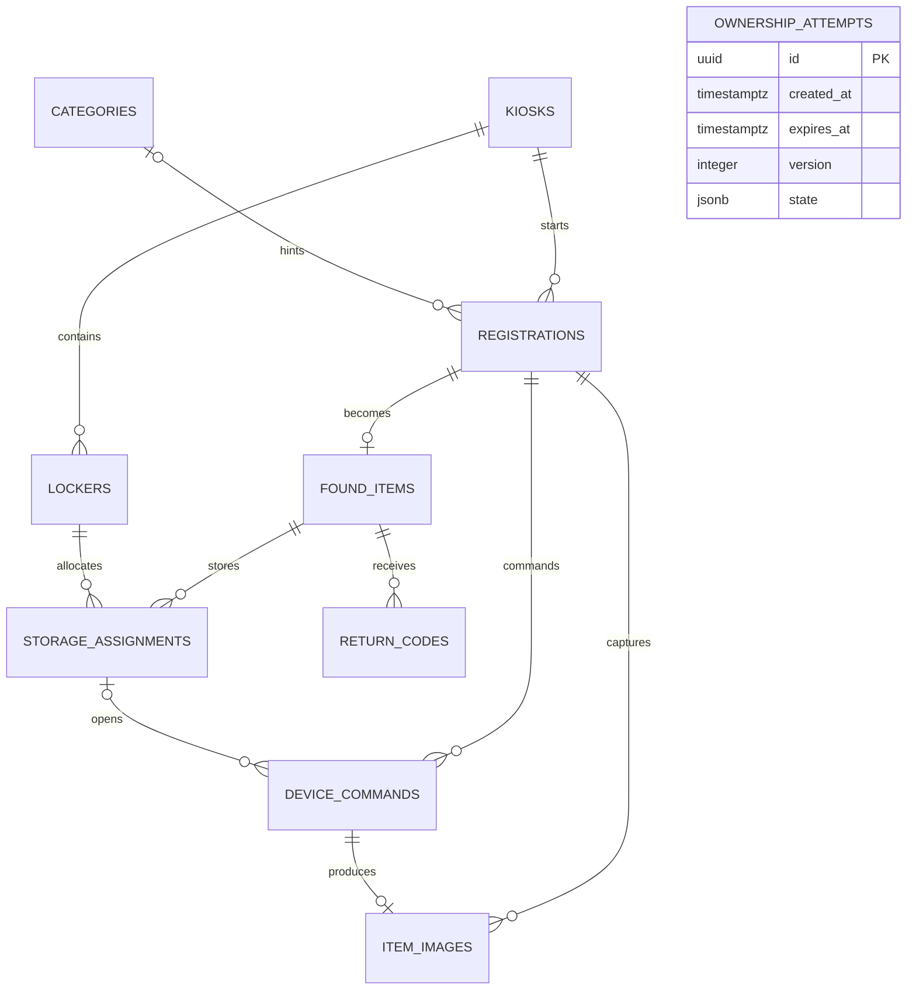

# 백엔드 ERD 명세

개정: 2026-11-16 · 기준: `7c001a8`, 이미지 처리 `51ea1d8`, 소유 확인 `development_v2`.

**현재 ORM·Alembic 0004에 반영한 구조다.** 사진 2장 촬영·S3 저장 다음 분석·검색·질문을 연결한다. [기능 명세](functional-spec.md), [구현 계획](implementation-plan-20261116.md)을 함께 따른다.

## 1. 저장 원칙

- 원본 JPEG는 기존 비공개 S3에 유지한다. DB에는 `item_images.object_key`와 촬영 순서·용량을 저장한다. 사진 바이트와 만료되는 미리보기 URL을 DB에 넣지 않는다.
- 분석은 **기존 registration 갱신**이다. 성공 시 `analysis_features`에 검증된 8개 특징만 저장한다. 전체 모델 응답 문자열이나 HTTP envelope를 저장하지 않는다.
- 분석 버전·실행 정보와 사람이 검토한 소유 근거는 각각 **새 `analysis_metadata`, `ownership_evidence` JSONB 컬럼**으로 분리한다.
- 분석 성공 시 `found_items`를 만들지 않는다. 기존처럼 보관함 배정·개방 단계에서 생성하고, 투입 완료 후 검색 대상이 된다.
- 기존 10개 테이블과 `ownership_attempts.state` JSONB를 활용한다. 특징·질문·답변별 테이블이나 벡터 DB를 이번 차수에 추가하지 않는다.

## 2. 실제 관계



`ownership_attempts.state.candidates[]`는 복수 물건 ID와 특징 스냅샷을 참조하지만 물리 FK가 아니다. 현행 `return_codes`에도 소유 확인 시도 FK는 없다. 과거 초안의 `devices`, `item_features`, `verification_attempts/questions/answers`는 실제 테이블이 아니며 이번에도 만들지 않는다.

## 3. registrations: 분석 저장의 기준 행

공통 `id`는 UUID PK, `created_at`은 timezone-aware 시각이다. PostgreSQL에서는 JSONB, SQLite 테스트에서는 JSON을 쓴다.

| 컬럼 | 타입 / NULL | 의미 |
| --- | --- | --- |
| kiosk_id | UUID FK, 필수 | 최초 등록 키오스크 |
| primary_category_id | UUID FK, 허용 | 습득자 선택. 모델 분류로 덮어쓰지 않음 |
| secondary_description | text, 허용 | 기존 선택 입력 유지. 이미지 분석 프롬프트에 넣지 않음 |
| found_location | varchar(200), 허용 | 습득 장소. 사진에서 추론하거나 키오스크 위치로 대체하지 않음 |
| status | text, 필수 | draft/capturing/analyzing/ready/opening/awaiting_deposit/stored/blocked |
| analysis_status | text, 필수 | pending/running/succeeded/failed |
| analysis_input_image_ids | JSONB, 허용 | 이번 분석 입력 UUID 2개, 촬영 순서대로. 실패 후에도 대조용으로 유지 |
| analysis_features | JSONB, 허용 | 성공한 Features의 8개 키. 분석 전·실패 시 NULL |
| **analysis_metadata** | **JSONB, 허용, 0004 추가** | 성공 결과의 버전·출처·실행 정보. 분석 전·실패 시 NULL |
| **search_features** | **JSONB 객체, 필수, 0004 추가** | 정규화 검색 토큰. 기본값 `{}`. GIN(jsonb_path_ops) 인덱스 |
| **ownership_evidence** | **JSONB 배열, 필수, 0004 추가** | 검토된 특징 목록. DB 기본값 `[]`. 새 분석 시작 시 비움 |

### 3.1 analysis_features

[이미지 스키마](../../imageprocess/docs/feature-schema.json)가 원본이다. 키는 모두 필수이며 값은 nullable이다. 빈 배열은 null로 정규화한다. null은 미확인이지 해당 특징이 없다는 증거가 아니다.

| 필드 | 타입 | 의미·언어 |
| --- | --- | --- |
| category | string / null | 모델이 본 종류, 영어 snake_case 요청 |
| color | string[] / null | 주요 색부터, 영어 기본 색상명 요청 |
| shape | string / null | 전체 형태, 한국어 요청 |
| surface_texture | string / null | 관찰한 표면 질감·광택, 한국어 요청. 재질 성분을 뜻하지 않음 |
| brand | string / null | 표기·로고·특징적 외형 기반 브랜드 추정 |
| visible_text | string[] / null | 실제 읽히는 문구 원문 |
| structure | string[] / null | 지퍼·손잡이 등 보이는 구조, 한국어 요청 |
| distinctive_features | string[] / null | 부착물·무늬·흔적·외형 근거를 동반한 캐릭터 식별 등 |

언어·사실성은 프롬프트 지침이며 타입 검증만으로 보장하지 않는다. material, description을 새 결과에 추가하지 않는다. 성공에는 color/shape/surface_texture/visible_text/structure/distinctive_features 중 하나 이상의 관찰값이 필요하다. 카테고리·브랜드만 있는 결과는 실패다.

저장 예시(구조 설명용, 실제 추론 결과 아님):

```json
{
  "category": "pencil_case",
  "color": ["black"],
  "shape": "길쭉한 직사각형",
  "surface_texture": "격자 모양의 직조 질감",
  "brand": "Carhartt",
  "visible_text": ["carhartt"],
  "structure": ["측면 지퍼", "상단 고리"],
  "distinctive_features": ["상단에 파란 원형 핀이 부착되어 있다."]
}
```

### 3.2 analysis_metadata

성공 결과와 같은 트랜잭션으로 저장한다. 다음은 목표 구조 예시이며 실제 추론 결과가 아니다.

```json
{
  "analysis_id": "44444444-4444-4444-4444-444444444444",
  "schema_version": "fixed_common_v2",
  "provider": "gemini",
  "model": "gemini-3.6-flash",
  "input_category": "필통",
  "analyzed_at": "2026-11-16T03:00:00Z",
  "image_sha256": ["<first-original-sha256>", "<second-original-sha256>"],
  "prompt_sha256": "<prepared-prompt-sha256>",
  "generation_config": {"temperature": 0, "max_output_tokens": 8192},
  "warnings": ["shot_1:IMAGE_BLURRY"],
  "usage": null
}
```

analysis_id는 BE가 실행마다 발급한다. 입력 사진 ID는 기존 컬럼에, 해시는 같은 순서로 기록한다. usage는 제공자 사용량 객체 또는 null이다. 키·원본 사진·전체 프롬프트·제공자 오류 본문은 포함하지 않는다. 현재 결과만 보관하며 분석 실행별 이력 테이블은 이번 범위에 없다.

### 3.3 ownership_evidence

이미지 모델이 생성하지 않는다. 초기값은 `[]`이며 내부 검토 도구가 담당자의 검토 파일을 검증하여 저장한다. 다음은 **사진과 추출값을 검토한 후의 예시**다.

```json
[
  {
    "analysis_id": "44444444-4444-4444-4444-444444444444",
    "feature_id": "distinctive_features:0",
    "field": "distinctive_features",
    "value": "상단에 파란 원형 핀이 부착되어 있다.",
    "group": "attachment",
    "visibility": "private",
    "verified": true,
    "distinguishing": true,
    "reviewed_by": "reviewer-identifier",
    "reviewed_at": "2026-11-16T03:10:00Z"
  }
]
```

- feature_id는 `필드:배열인덱스`, scalar는 `필드:0`이다. 분석 안에서 유일하고 value는 원본 항목과 정확히 일치해야 한다. analysis_id가 달라지면 재사용하지 않는다.
- visibility는 FE 노출 가능 여부, verified는 사람이 사진 근거를 확인했는지, distinguishing은 구별에 쓸 수 있는지다. JSON 검증·모델 확신·브랜드 인식으로 자동 승인하지 않는다.
- 서버 접근 권한이 있는 개발 담당자의 **로컬 CLI**로 검토 목록을 저장한다. 공개 검토 API·관리자 UI는 이번 범위에 없다. reviewed_by는 기록용 식별자이며 인증 테이블 FK가 아니다.
- 기존 선택지 계약에 맞춰 value는 1~100자인 원문 항목만 채택한다. 긴 문장을 자르거나 모델로 재작성하지 않는다. 검토 목록은 최대 20개다.
- 질문에는 private + verified + distinguishing이며 사용자가 처음 말하지 않은 특징을 사용한다. 같은 물리적 근거를 다른 필드로 표현하면 같은 group을 부여해 오답을 중복 계산하지 않는다.
- 현재 한 필드당 한 문항 구조를 유지한다. 검토자가 필드별 하나의 명확한 근거를 선택하며 여러 유효 근거가 남은 필드는 질문에서 제외한다. 한 문장의 두 핀을 자동으로 두 독립 증거로 나누지 않는다.
- 근거가 없어도 분석 저장·유사 검색은 정상이다. 소유 확인은 insufficient_evidence로 보류할 수 있다.

## 4. 나머지 실제 테이블과 제약

| 테이블 | 주요 컬럼·제약 |
| --- | --- |
| kiosks | name, location_description, latitude/longitude. 좌표 동시 NULL·범위 CHECK |
| categories | code UNIQUE, name. 입력 카테고리 FK의 원본 |
| lockers | kiosk_id FK, locker_number > 0, UNIQUE(kiosk_id, locker_number) |
| item_images | registration_id FK, capture_command_id UNIQUE FK, shot_order 1/2, object_key UNIQUE NOT NULL, JPEG content_type, byte_size > 0, received_at. UNIQUE(registration_id, shot_order) |
| found_items | registration_id UNIQUE FK, status=awaiting_deposit/stored/retrieved |
| storage_assignments | found_item_id·locker_id FK, status=reserved/awaiting_deposit/stored/awaiting_pickup/retrieved/cancelled, deposited_at, ended_at |
| device_commands | command_id text PK, registration_id FK, action=capture/open/pickup_open, shot_order, storage_assignment_id FK, expires_at, status=sent/succeeded/failed/unknown, error_code |
| return_codes | found_item_id FK, code_hash UNIQUE, status=active/opening/used/locked/revoked, expires_at, used_at, failed_attempts |
| ownership_attempts | UUID PK, created_at, expires_at(index), version, state JSONB |

storage_assignments는 ended_at IS NULL에 대해 물건·칸 각각 부분 UNIQUE를 유지한다. retrieved/cancelled와 ended_at의 일치 CHECK도 유지한다. return_codes는 물건별 active/opening 부분 UNIQUE와 used_at 일치 CHECK를 유지한다. 장치 주소는 PI_DEVICES 설정이다.

item_images 행은 S3 저장 성공 후 생성한다. 과거 초안의 storage_status 컬럼은 없다. S3 성공 후 DB 실패로 남는 객체 정리는 별도 운영 과제다.

## 5. 검색과 질문 데이터 경로

조회는 found_items → registrations와 현재 storage_assignments를 join한다. **물건·등록·배정 모두 stored, ended_at IS NULL, analysis_status=succeeded**인 항목만 읽는다. 아직 ready인 분석 결과는 검색에 나오지 않는다.

새 검색 데이터는 8개 특징과 found_location에서 만든 location이다. 사용자 카테고리는 모델 category가 null인 경우에만 name을 fallback으로 사용한다. 서로 모순되는 두 종류를 합치지 않는다. secondary_description은 자동 관찰 근거로 사용하지 않는다.

`search_features`는 원본 8개 특징+found_location에서 만든 `{필드:[정규화 토큰]}`이다. 예: `{"category":["pencilcase"],"color":["black"]}`. `ix_registrations_search_features` GIN(jsonb_path_ops)와 JSONB `@>`로 겹치는 특징을 조회한다. 전체 물품을 앱에 로드하지 않는다. 후보 51개를 읽어 50개 초과면 refine_search, 그 이하면 단순 단서는 DB 값 비교, 상세 단서는 한 번의 후보 의미 비교를 수행한다. 현재 등록량 500개 제한은 제거했다. 상세 규칙·정규화 한계는 기능 명세 F09를 따른다.

Alembic 0004는 기존 성공 분석 행을 200개씩 읽어 공통 구필드(category/color/brand/visible_text/distinctive_features)와 습득 위치만 색인한다. raw JSON과 기존 envelope는 보존하고 material→surface_texture 변환·기존 근거 자동 승인은 하지 않는다. 정규화 규칙을 바꿀 때는 별도 데이터 마이그레이션으로 기존 색인도 갱신해야 한다. 요청 중 전체 스캔 fallback은 없다.

ownership_attempts.state에는 후보별 item_id·analysis_id, 근거와 그 전체 검토 목록의 해시·공개 질문용 값, 초기 언급 필드, 현재 질문·선택지, 답변 이력·판정이 들어간다. version은 낙관적 잠금에 사용한다. JSON 참조는 시작·답변·최종 인계 시 서비스가 보관 상태와 분석 버전을 검증한다. 현재 정책 버전은 development_v3다.

## 6. 트랜잭션과 전이

| 시점 | 원자적으로 저장할 내용 |
| --- | --- |
| 분석 시작 | 등록 상태 조건부 확보, analyzing/running, 입력 사진 ID, 이전 특징·metadata 비우기, search_features={}, evidence=[] |
| 외부 처리 | DB 트랜잭션 종료 후 S3 read → prepare → Gemini → parse. 외부 대기 중 DB 행 잠금을 유지하지 않음 |
| 분석 성공 | 입력 ID·순서 재확인 후 features + metadata + search_features + ready/succeeded 함께 커밋 |
| 알려진 실패 | draft/failed, features·metadata=NULL, search_features={}, evidence=[]. 사진·S3 객체·입력 ID 유지 |
| 근거 검토 저장 | analysis_id·원문 참조 확인 후 목록 전체 교체. 조건 불일치 시 거절 |
| 질문 시작 | 후보/근거 스냅샷·첫 질문 또는 보류 판정을 state에 저장. 20분 만료, version=1 |
| 답변 제출 | 질문·선택지 확인 후 다음 상태를 WHERE version=기대값 조건으로 저장 |

키 미설정·사진 부족·진행 중 요청은 시작 전 거절해 상태를 바꾸지 않는다. 프로세스 종료·DB 장애의 analyzing 잔류는 알려진 실패와 구분하고 자동 재추론하지 않는다. 질문 생성 실패는 답변을 부분 커밋하지 않는다.

## 7. 마이그레이션과 구버전

revision은 `0004_image_analysis_contract`, 부모는 `0003_ownership_attempts`다. registrations에 nullable analysis_metadata, NOT NULL·기본값 []인 ownership_evidence, NOT NULL·기본값 {}인 search_features와 GIN 인덱스를 추가했다.

기존 analysis_features와 ownership_attempts.state는 마이그레이션으로 재작성하지 않는다. 구버전 raw dict 또는 {data, ownership_evidence}는 호환 경로에서 category/color/brand/visible_text/distinctive_features만 검색에 사용하고 새 3개 필드는 미확인으로 둔다. material을 surface_texture로 치환하거나 description에서 특징을 만들지 않는다. 구버전 검토 근거는 새 검토 완료 근거로 자동 승격하지 않는다.

새 분석부터 data-only 저장을 적용한다. 아직 물건이 생성되지 않은 구버전 ready 등록은 명시적 분석 POST로 재분석할 수 있다. 이미 보관 중인 물건은 자동 재분석하지 않는다. 기존 완료 v1/v2 시도는 이력 조회만 허용하고 새 반환 승인 근거로 재사용하지 않는다. 진행 중인 구버전 시도는 재시작을 요구한다.

기존 JSON 보존·공통 특징 backfill, upgrade/downgrade·ORM 일치를 PostgreSQL과 SQLite에서 검증한다. downgrade는 새 세 컬럼의 데이터를 잃으므로 운영에서는 백업 후 수행한다.
