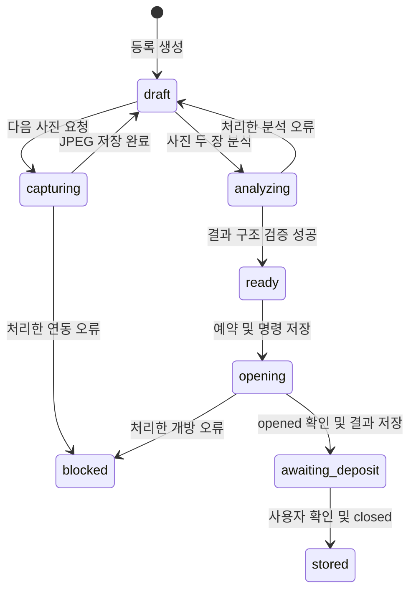
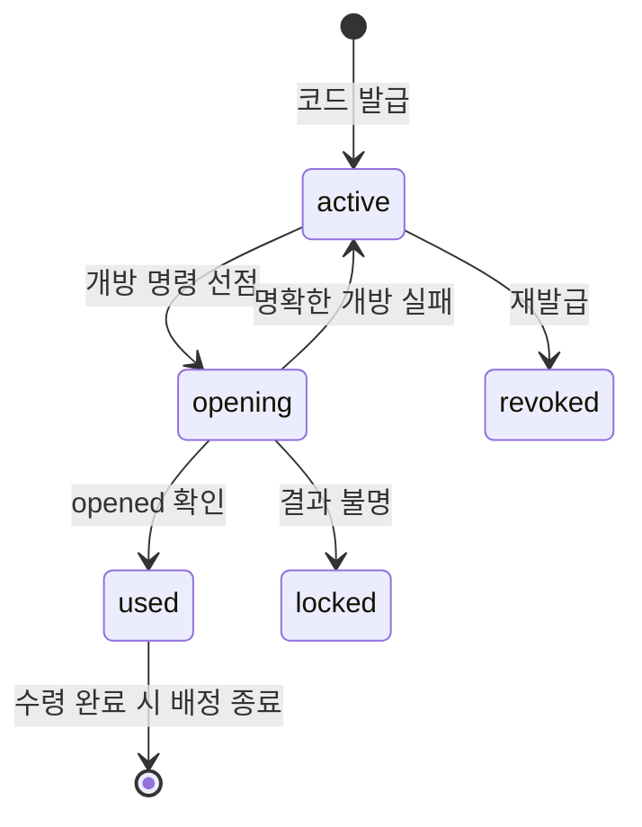

# 백엔드 기능 명세

기준: `back_pickup-return-code` 작업 트리

구현된 기능과 동작 순서를 정리한다. 물리 스키마는 [ERD](erd.md), 요청·응답 예시는 [개발용 API 계약](../../docs/api.md), 파트 간 협의 항목은 [연동 협의](integration-agreements.md), 결정 이력은 [검토 기록](spec-review.md)에 있다.

## 1. 범위

| 구성 | 현재 상태 |
| --- | --- |
| 웹 → 백엔드 | 등록·촬영·분석 요청·보관함 개방·투입 완료, 반환 코드 발급·수령 개방·수령 완료 |
| 백엔드 → 촬영 Pi | HTTP로 JPEG 1장 요청. 같은 등록에 사용자가 순서대로 2회 요청 |
| 백엔드 → 보관함 Pi | 등록용·수령용 개방 요청, 완료 시 문 상태 조회 |
| 백엔드 → S3 | JPEG 업로드·읽기, 임시 서명 URL 생성 |
| 백엔드 → 이미지 AI | 교체 가능한 연결부만 구현. 기본 분석기는 `AI_NOT_CONFIGURED` |
| 소유 확인 AI | Gemini 질문 생성 실험 코드·CLI. 업무 API·DB에 미연결 |
| 답변 평가 | 미구현. 담당·입출력 미정(A04) |

업무 API는 `LOCAL_DEVELOPMENT` 또는 `BUSINESS_API_ENABLED` 중 하나가 true일 때 활성화된다. 둘 다 기본 false이며 비활성 상태는 503 `BUSINESS_API_DISABLED`다. 이는 기능 활성화 설정이고 로그인·키오스크 인증·요청자별 접근 권한 검사가 아니다. 활성화된 업무 API는 인증 없이 호출할 수 있다. `/health`, `/ready`에는 이 설정을 적용하지 않는다.

Pi 주소와 역할별 API 키는 서버의 `PI_DEVICES`에서 읽는다. 웹 입력으로 Pi 주소를 받지 않는다.

## 2. 기능 목록

| ID | 기능 | 상태 |
| --- | --- | --- |
| F01 | 서버 상태 확인 | 구현 |
| F02 | DB 준비 상태 확인 | 구현 |
| F03 | 키오스크 위치 조회 | 구현. 목록·페이지네이션 |
| F04 | 카테고리 조회·물건 검색 | 카테고리 조회 구현. 검색은 내부 함수만, 공개 API 없음 |
| F05 | 등록 생성·조회 | 구현. 수정·취소·만료 없음 |
| F06 | 순차 촬영 2회·저장·미리보기 | 구현. 재촬영 없음 |
| F07 | 보관함 배정·등록용 개방 | 구현 |
| F08 | 이미지 특징 추출 연결 | 연결부 구현. 실제 분석기 미연결 |
| F09 | 물품 소유 확인 | 질문 생성만 실험 구현. 답변 평가·판정 미구현 |
| F10 | 반환 코드 발급 | 구현. 발급 승인 근거 없음 |
| F11 | 반환 코드로 보관함 개방 | 구현 |
| F12 | 문 상태·완료 확인 | 투입 완료·수령 완료 구현 |
| F13 | 장치 역할·명령·오류 관리 | 구현. 운영 복구 없음 |

## 3. API 목록

업무 12개와 상태 확인 2개다. 촬영은 `shot_order=1 또는 2`를 받는 하나의 경로다.

| 메서드 | 경로 | 용도 |
| --- | --- | --- |
| GET | `/health` | 서버 응답 확인 |
| GET | `/ready` | DB 연결 확인 |
| GET | `/api/kiosks` | 키오스크 위치 목록 |
| GET | `/api/categories` | 카테고리 목록 |
| POST | `/api/registrations` | 등록 생성 |
| GET | `/api/registrations/{registration_id}` | 등록 조회 |
| POST | `/api/registrations/{registration_id}/shots/{shot_order}` | 촬영·저장 |
| GET | `/api/registrations/{registration_id}/shots/{shot_order}/preview` | 임시 서명 URL |
| POST | `/api/registrations/{registration_id}/analysis` | 특징 추출 요청 |
| POST | `/api/registrations/{registration_id}/deposit/open` | 빈 칸 배정·개방 |
| POST | `/api/registrations/{registration_id}/deposit/complete` | 투입 완료 |
| POST | `/api/found-items/{found_item_id}/return-code` | 반환 코드 발급 |
| POST | `/api/pickup/open` | 코드 확인·수령 개방 |
| POST | `/api/pickup/{found_item_id}/complete` | 수령 완료 |

등록 공통 응답은 `id, kiosk_id, primary_category_id, secondary_description, status, analysis_status, images, locker_number`다. `images`에는 사진 `id`와 `shot_order`만 담는다. `analysis_features`·S3 객체 키·장치 명령·주소는 응답에 넣지 않는다. `locker_number`는 개방 성공이 저장된 `awaiting_deposit`·`stored`에서만 반환한다.

수령 공통 응답은 `found_item_id, kiosk_id, locker_number, item_status, assignment_status`다. 발급 응답의 `code`는 이때 한 번만 전달하며 재조회 경로가 없다.

업무·연동 오류는 `{"detail":{"code":"ERROR_CODE"}}` 형식이다. 입력 검증 실패는 FastAPI의 422 배열이다. Pi 오류의 HTTP 상태나 외부 메시지 원문을 그대로 전달하지 않는다. 코드 목록은 [API 계약](../../docs/api.md)에 있다.

## 4. 기능별 동작

### F01·F02 상태 확인

`GET /health`는 DB를 쓰지 않고 `{"status":"ok"}`를 반환한다. 요청을 처리하는 서버의 상태이며 S3·Pi·Gemini 연결이나 스키마 준비를 확인하지 않는다.

`GET /ready`는 세션에서 `SELECT 1`을 실행한다. 실패하면 503이며 DB 연결 정보·예외 원문을 응답에 넣지 않는다. 마이그레이션 버전이나 업무 테이블까지 검증하지는 않는다.

### F03 키오스크 위치 조회

`GET /api/kiosks`는 이름·ID 순으로 `id, name, location_description, latitude, longitude`를 반환한다. 좌표와 장소 설명은 null일 수 있다. 현재 위치 입력·반경 검색·빈 칸 수·위치 관리 API는 없다.

[로컬 시드](../app/seed_local.py)는 `LOCAL_DEVELOPMENT=true`일 때 고정 UUID의 개발용 키오스크와 1·2번 칸을 생성한다. 카테고리는 만들지 않는다.

### F04 카테고리와 내부 검색

`GET /api/categories`는 DB 행을 `code` 순으로 반환한다. 확정 목록이나 관리 API는 없다.

`search_stored_items()`는 내부 서비스 함수다. 물건과 배정이 모두 `stored`이고 `ended_at IS NULL`인 건만 대상으로 `category_id`·`kiosk_id`를 정확 일치 필터링한다. 자유 특징·색상·유사도·AI 검색은 없다. 개방 후 투입 대기와 수령 진행 중인 물건은 제외된다.

`/api/items` 같은 공개 검색 경로는 없다. 공개 필드·후보 선택·카테고리 필수 여부는 A06에서 합의할 사항이다.

### F05 등록 생성·조회

요청 키오스크가 존재하는지 확인하고, 카테고리를 지정했으면 해당 행도 확인한다. 등록 UUID를 만들고 사용자 입력을 저장한다. 최초 상태는 `draft`, 분석 상태는 `pending`이다.

생성 POST는 멱등하지 않으므로 같은 본문을 다시 보내면 새 등록이 생긴다. FE는 받은 ID를 보관해 후속 요청에 재사용한다. 입력 수정·취소·등록 TTL·요청자별 권한은 없다.

### F06 순차 촬영·저장·미리보기

1. 같은 순서의 사진이 이미 있으면 기존 사진을 재사용한다. 새 촬영은 `draft` 등록에서만 시작한다.
2. 저장된 사진 수가 요청 순서보다 하나 적은지 확인한다. 첫 사진 없이 2번을 요청하면 409 `SHOT_OUT_OF_ORDER`다.
3. `capturing` 상태와 명령 ID·만료 시각을 먼저 커밋한다.
4. 촬영 Pi에 JPEG 한 장을 요청하고 크기 상한·형식·실제 디코딩을 확인한다.
5. S3에 저장한 뒤 사진 행과 명령 `succeeded`를 기록하고 등록을 `draft`로 되돌린다.

촬영 요청마다 명령 ID는 다르고 등록 ID는 같다. FE는 JPEG를 중계하지 않는다. 미리보기는 등록과 사진의 존재를 확인해 S3 GET 서명 URL을 발급하며 DB에 저장하지 않는다. 요청자별 접근 검사는 없다.

처리한 촬영·JPEG·저장 오류는 등록을 `blocked`로 만들고 명령을 `failed` 또는 `unknown`으로 남긴다. 첫 사진은 보존되며 자동 재촬영은 없다.

### F07 빈 칸 배정·등록용 개방

1. `ready` 등록을 조건부 UPDATE로 `opening`에 진입시킨다.
2. 분석 상태 `succeeded`, 사진 순서 `[1,2]`, 현재 사진 ID와 분석 스냅샷 일치를 확인한다.
3. PostgreSQL에서는 키오스크 행을 잠근 뒤 유효 배정이 없는 칸을 작은 번호부터 선택하고 칸을 잠근다. 빈 칸이 없으면 409 `NO_AVAILABLE_LOCKER`이고 롤백해 `ready`를 유지한다.
4. 물건·예약 배정·개방 명령을 커밋한 뒤 Pi를 호출한다. Pi 응답을 기다리는 동안 배정 잠금을 잡지 않는다.
5. 대상 칸과 `result=opened`가 일치하면 등록·배정을 `awaiting_deposit`로 저장한다. 이때부터 API가 칸 번호를 반환한다.

작은 칸 번호 우선은 현재 구현 선택이며 사용자가 칸을 지정하지는 않는다. 처리한 개방 오류는 `blocked`로 두고 예약을 유지한다. 이미 `awaiting_deposit`·`stored`이면 기존 배정을 재사용하고 추가 명령을 보내지 않는다.

### F08 이미지 AI 분석 연결

| 항목 | 구현 |
| --- | --- |
| 호출 | `FeatureAnalyzer.analyze(registration_id, images)` |
| 입력 | 등록 UUID, 촬영 순서대로 사진 ID·JPEG 바이트를 담은 `AnalysisInput` 2개 |
| 결과 | `AnalysisResult(image_ids=(id1,id2), features=dict)` |
| 검사 | 결과 타입, 두 ID와 순서의 정확 일치, 비어 있지 않은 dict, `allow_nan=False`로 직렬화 가능 |
| 저장 | `analysis_input_image_ids`, `analysis_features`, `analysis_status` |
| 기본 분석기 | `UnconfiguredAnalyzer` → `AI_NOT_CONFIGURED` |

사진 두 장이 없으면 409 `TWO_IMAGES_REQUIRED`다. 시작 상태와 사진 ID 스냅샷을 먼저 커밋한 뒤 저장소에서 바이트를 읽고 분석기를 호출한다. 성공하면 등록 `ready`, 분석 `succeeded`로 저장한다. 처리한 연동 오류는 등록 `draft`, 분석 `failed`, 특징 `None`으로 되돌려 재요청할 수 있게 한다.

특징의 실제 정확성·필수 필드·공개 여부는 검증하지 않는다. 현재 `succeeded`는 연결부의 구조 검증을 통과했다는 뜻이다. 분석 함수에 카테고리를 별도 인자로 전달하지 않으므로, 사진 1장과 카테고리를 받는 [이미지 분석 파트](../../imageprocess/README.md)와 연결하려면 입력 계약을 맞춰야 한다(A03).

### F09 소유 확인: 질문 생성 실험

구현된 진입점은 `GeminiQuestionGenerator.generate(item: ItemEvidence)`와 실험 CLI다. 업무 라우터·DB·FE에 연결되지 않았다.

`ItemEvidence`는 물품 문자열 ID·카테고리·최대 20개 특징을 받는다. 특징은 `feature_id, name, value, visibility, verified, distinguishing`으로 구성한다. 비공개·확인됨·구별 가능·값이 있는 조건을 모두 만족하는 특징만 질문 근거로 쓰며, 해당 특징이 없으면 API 호출 없이 `insufficient_information`과 빈 질문 목록을 반환한다.

Gemini 응답은 구조화 JSON을 요청하고 HTTP 200·후보 1개·종료 사유 `STOP`을 확인한 뒤 Pydantic으로 상태·필수 필드·질문 수·중복 참조를 검증한다. 질문이 선별한 특징 ID를 참조하는지, 비공개 특징값 전체가 질문에 노출되지 않았는지도 확인한다. 비교는 Unicode NFKC·대소문자·공백을 정규화해 수행한다.

결과 `QuestionBatch`는 `status, questions, reason`이다. `ready`는 질문 준비 완료를 뜻하고 소유자 판정이나 반환 승인이 아니다. 영구 질문 ID·답변·승인 필드는 없다.

실제 추출 특징에 `visibility`·`verified`·`distinguishing` 표시를 부여하는 어댑터가 없어 현재 입력은 합성 사례의 수기 값이다. 사용자 답변 수집·평가, 검증 세션, 공개 API는 미구현이다. F10의 반환 코드는 이 질문 생성과 연결돼 있지 않다.

### F10 반환 코드 발급

`POST /api/found-items/{found_item_id}/return-code`는 보관 중인 물건에 일회성 코드를 발급한다.

1. 물건이 존재하고 `stored`인지 확인한다. 아니면 409 `ITEM_NOT_STORED`다.
2. 같은 물건의 `active`·`opening` 코드를 모두 `revoked`로 바꾼다. 유효한 코드는 항상 최대 1개다.
3. 5바이트 난수를 패딩 없는 base32 8자로 만들고, 정규화한 값의 SHA-256만 저장한다.
4. 201로 평문 코드와 만료 시각을 반환한다.

발급에 소유 확인·인증·요청자 권한 검사가 없다. 물건 ID를 아는 누구나 코드를 받을 수 있으므로 이 API를 공개 배포하지 않는다. 답변 평가(A04)가 정해지면 이 호출의 선행 조건이 된다.

평문은 발급 응답에서만 전달한다. DB·로그에 남기지 않아 재조회 경로가 없고, 분실하면 재발급해야 한다. `RETURN_CODE_TTL_SECONDS`가 없으면 503 `RETURN_CODE_NOT_CONFIGURED`다. 코드 길이·문자 집합·TTL은 구현 선택이며 합의된 정책이 아니다. 해시는 솔트 없는 SHA-256이고 호출 빈도 제한은 없다.

### F11 반환 코드로 보관함 개방

`POST /api/pickup/open`은 코드 확인부터 개방까지 한 요청으로 처리한다. 순서와 사용 처리 시점은 [장치 규약 6.2](../../docs/device-protocol.md)를 따른다.

1. 입력의 공백·하이픈을 제거하고 대문자로 정규화해 해시로 코드 행을 찾는다. 없으면 404다.
2. 코드에서 물건·유효 배정·칸·키오스크를 따라가 요청의 `kiosk_id`와 대조한다. 다르면 409 `RETURN_CODE_WRONG_KIOSK`다.
3. 배정이 이미 `awaiting_pickup`이면 문을 다시 열지 않고 기존 결과를 반환한다.
4. 코드 상태·만료와 물건·배정이 `stored`인지 확인한다.
5. 코드를 `active → opening`으로 조건부 UPDATE해 선점한다. 실패하면 409 `RETURN_CODE_IN_PROGRESS`다.
6. 개방 명령을 커밋한 뒤 보관함 Pi를 호출한다. 성공하면 코드 `used`, 배정 `awaiting_pickup`을 저장하고 칸 번호를 반환한다.

수령 개방 명령의 `action`은 `pickup_open`이며 해당 물건의 등록 ID를 함께 기록한다. Pi는 등록용 개방과 수령용 개방을 구분하지 않는다.

명확한 장치 실패는 코드를 `active`로 되돌리고 `failed_attempts`를 올려 재시도를 허용한다. 결과 불명은 코드를 `locked`로 두어 같은 코드의 재개방을 막는다. 문이 이미 열렸고 누군가 물건을 가져갔을 수 있기 때문이며, 해소하는 경로는 없다.

키오스크 대조는 코드가 가리키는 칸이 맞는지 확인하는 것이고 호출자 인증이 아니다. 키오스크 세션이 없어 현재 `kiosk_id`는 요청 본문으로 받는다. `failed_attempts`는 기록용이며 이 값으로 코드를 차단하지 않는다.

### F12 문 상태와 완료 확인

투입 완료와 수령 완료가 같은 구조를 따른다. 둘 다 `{"confirmed":true}`와 센서 `closed`를 함께 확인하며, 센서가 닫혔다는 이유만으로 자동 완료하지 않는다. 중간의 `open` 관측은 요구하지 않는다.

투입 완료 `POST /api/registrations/{id}/deposit/complete`

1. 등록·배정이 `awaiting_deposit`이어야 한다.
2. 해당 칸의 문 상태를 조회한다. `open`이면 409 `DOOR_NOT_CLOSED`이고, 통신·응답 오류이면 완료하지 않는다.
3. 등록 행을 다시 잠그고 재조회한 뒤 등록·물건·배정을 `stored`로 함께 커밋한다. 첫 `deposited_at`을 보존한다.

수령 완료 `POST /api/pickup/{found_item_id}/complete`

1. 배정이 `awaiting_pickup`이어야 한다. 아니면 409 `PICKUP_NOT_OPENED`다.
2. 문 상태를 조회해 `closed`를 확인한다.
3. 물건 행을 다시 잠그고 재조회한 뒤 물건·배정을 `retrieved`로 바꾸고 배정 `ended_at`을 채운다.

두 완료 모두 재요청하면 기존 결과를 반환하고 센서를 다시 조회하지 않는다.

배정 종료가 칸을 반납한다. `ended_at`을 채우면 부분 UNIQUE 인덱스 조건에서 빠져 해당 칸이 즉시 재배정 가능해지며, 수령 완료가 배정을 종료하는 유일한 경로다.

물건을 실제로 꺼냈는지는 확인하지 않는다. 문 센서는 개폐만 알리므로 물건을 두고 문만 닫은 뒤 완료를 눌러도 같은 결과가 된다. `confirmed=true`가 사용자 선언이며 FE 완료 화면이 이를 분명히 물어야 한다. 투입 완료도 같은 한계를 갖지만, 잘못된 수령 완료는 다음 등록이 그 칸을 배정받는다는 점에서 영향이 더 크다. 보관함 내부 감지 수단은 하드웨어 협의 대상이다.

수령은 등록 상태를 바꾸지 않는다. 물건의 생애주기는 `found_items`가 담당한다. 수령 완료를 되돌리는 경로는 없다.

### F13 장치 역할·명령·오류 관리

아래는 웹 API가 아닌 백엔드가 호출하는 Pi API다.

| Pi 호출 | 백엔드 구현 |
| --- | --- |
| `GET /health` | 촬영·개방 전에 `status=ok`와 `role=capture/locker` 확인 |
| `POST /capture` | `command_id, registration_id, expires_at` 전달. 200과 JPEG Content-Type 검사 |
| `POST /lockers/{locker_number}/open` | `command_id, expires_at` 전달. 200, 정수 칸 번호 일치, `opened` 검사 |
| `GET /lockers/{locker_number}` | 정수 칸 번호 일치, `door=open/closed` 검사. 앞에 역할 검사를 하지 않음 |

역할 주소나 timeout이 없으면 `DEVICE_NOT_CONFIGURED`다. 설정된 역할별 키가 있으면 `X-API-Key`를 보낸다. 촬영 성공 응답은 이미지 크기 설정으로, 다른 응답은 65,536바이트로 읽기를 제한한다.

네트워크 오류는 `DEVICE_UNREACHABLE`, 잘못된 응답은 `INVALID_DEVICE_RESPONSE`, 과대 응답은 `DEVICE_RESPONSE_TOO_LARGE`이며 모두 결과 불명으로 다룬다. 규약에 정의된 상태·코드 조합만 명확한 오류로 전달한다. HTTP 자동 재시도·리다이렉트는 없고, 역할 불일치는 명령 전에 차단한다. 명령 조회·운영 복구·예약 자동 해제 API는 없다.

## 5. 상태 전이

등록은 다음과 같이 움직인다.

보관 완료 이후의 수령은 등록이 아니라 물건·배정·반환 코드의 상태로 진행한다.

물건은 `stored → retrieved`, 배정은 `stored → awaiting_pickup → retrieved`로 움직인다. 수령 개방 중에도 물건은 `stored`를 유지하며, 검색에서 빠지는 일은 배정 상태가 담당한다.

진행 상태는 외부 호출 전에 커밋한다. 프로세스 중단이나 DB 결과 기록 실패가 생기면 `capturing/analyzing/opening`과 명령 `sent`, 코드 `opening`이 남을 수 있다. 자동 재개 전이는 없으며 재요청으로 하드웨어를 다시 실행하지 않는다.

## 6. 남은 작업

| 범위 | 필요한 내용 |
| --- | --- |
| 이미지 AI 연결 | 실제 분석기, 사진 1장·2장 입력 계약, 카테고리 전달, 특징 규격(A03) |
| 질문 생성 연결 | 특징 표시 어댑터, 질문·답변 세션, 공개 응답 분리(A04) |
| 발급 승인 근거 | 답변 평가와 승인 기준. 현재 발급은 소유 확인 없이 호출된다 |
| 공개 검색 | 공개 필드·후보 선택·카테고리 필수 여부(A06) |
| 인증·권한 | 로그인·키오스크 세션·요청자별 접근 검사(A08) |
| 수령의 물건 확인 | 물건을 꺼냈는지 판별할 수단. 현재는 사용자 선언만 근거다 |
| 복구·수명주기 | `locked` 코드와 `unknown` 명령의 해소, 재촬영, 취소·만료, S3/DB 부분 실패 정리, 보존 기간 |
