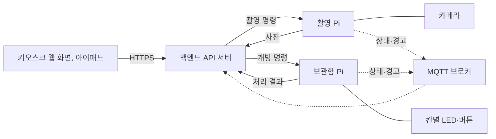
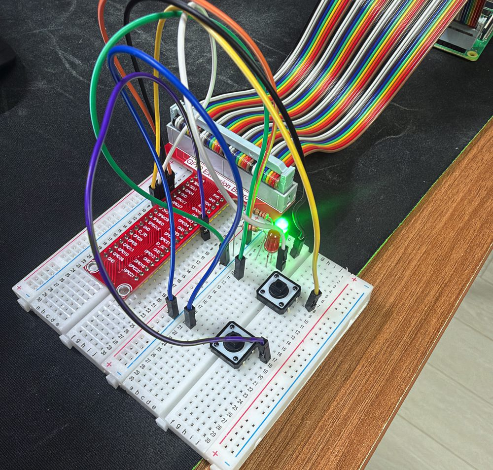
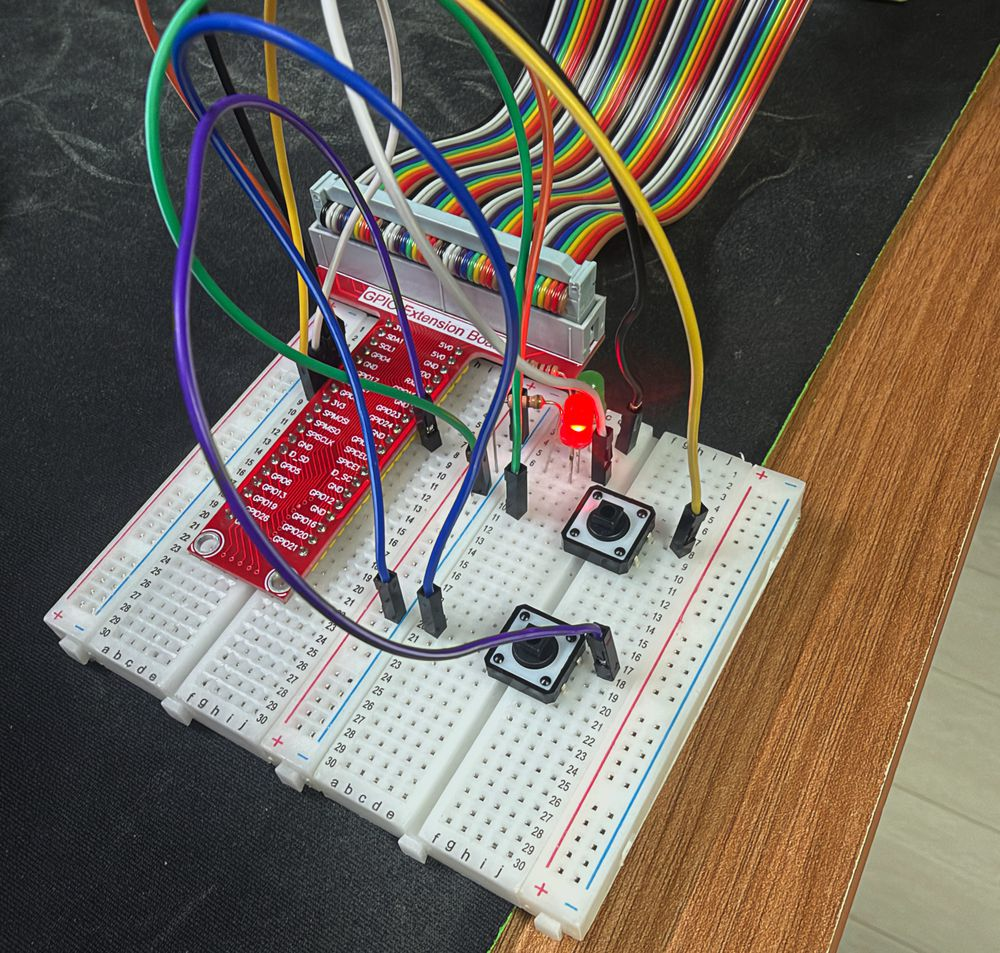

# smart-lost-found Raspberry Pi

키오스크 현장의 하드웨어를 제어하는 라즈베리파이 파트. 라즈베리파이 두 대를 쓴다. 촬영 Pi는 촬영 상자의 카메라를, 보관함 Pi는 보관함의 잠금장치와 문 센서를 맡는다. 두 Pi 모두 백엔드의 명령을 받아 하드웨어를 움직이고, 결과를 백엔드에 돌려준다.

현재 두 Pi에 컨트롤러를 설치해 Tailscale로 백엔드(EC2)와 연결했다. 촬영 Pi는 실제 카메라로 찍고, 보관함 Pi는 잠금장치 대신 칸마다 LED와 버튼으로 동작을 보여 준다([결정 기록 0002](docs/decisions/0002-locker-led-button.md)). 백엔드와 주고받는 요청·응답은 [docs/device-protocol.md](../docs/device-protocol.md)에 정리했다.

보관함 상자와 센서는 실제로 만들지 않는다. 문·충격·무게 센서가 있다고 가정한 가상 센서로 강제 개방, 보관 안 됨, 수령 안 됨, 촬영 상자에 남은 물건 같은 이상 상황을 판단하고 MQTT로 알린다([결정 기록 0004](docs/decisions/0004-virtual-sensors.md), [MQTT 규약](../docs/mqtt-protocol.md)).

## 문서

| 문서 | 내용 |
| --- | --- |
| [통신 규약](../docs/device-protocol.md) | 백엔드와 두 Pi가 주고받는 API, 오류, 흐름 |
| [설치와 접속](deploy/setup.md) | 운영체제 설치, 카메라 연결, SSH 접속, 핫스팟·Tailscale, 컨트롤러 설치와 자동 실행 |
| [문제 해결 기록](docs/troubleshooting.md) | 막혔던 문제와 원인·해결 |
| [실험 0001](docs/experiments/0001-camera-first-test.md) | 카메라 초점·촬영 시간과 사진 크기 |
| [실험 0002](docs/experiments/0002-mqtt-alert-test.md) | 실제 Pi로 MQTT 경고 종단 시험: 경고 6가지, 완료 막기·다시 열기, 도난 시 DB 반영 |
| [실험 0003](docs/experiments/0003-kiosk-real-pi-test.md) | 키오스크 화면 확인과 실제 Pi 등록 시험, 고칠 점과 우회 방법 |
| [하드웨어 설계](hardware/README.md) | 촬영 모듈·보관함 모듈 3D 배치, 배선, 설계 점검 |
| [결정 기록 0001](docs/decisions/0001-single-camera-two-shots.md) | 카메라 1대로 물건 방향을 바꿔 2장 촬영 |
| [결정 기록 0002](docs/decisions/0002-locker-led-button.md) | 시제품 보관함은 잠금장치 대신 LED와 버튼 |
| [결정 기록 0003](docs/decisions/0003-mqtt-device-status.md) | 물건 유무와 장치 상태를 MQTT로 알리기 |
| [결정 기록 0004](docs/decisions/0004-virtual-sensors.md) | 보관함은 만들지 않고 가상 센서로 이상 상황을 시뮬레이션 |
| [결정 기록 0005](docs/decisions/0005-kiosk-ipad.md) | 키오스크 화면은 촬영 Pi 모니터 대신 아이패드 |
| [MQTT 규약](../docs/mqtt-protocol.md) | 두 Pi가 MQTT로 보내는 상태·이벤트·경고의 토픽과 형식 |

## 구성

| Pi | 연결 장치 | 하는 일 |
| --- | --- | --- |
| 촬영 Pi | 카메라 1대(Camera Module 3), 가상 무게 센서(촬영 상자) | 분실물 촬영(방향을 바꿔 2장), 촬영 상자에 남은 물건 알림 |
| 보관함 Pi | 칸마다 LED와 버튼, 가상 문·충격·무게 센서 (잠금장치는 향후 과제) | 열린 칸 표시, 문 닫힘 확인, 강제 개방·보관 안 됨·수령 안 됨 알림 |

사진을 2장 찍는 이유: 물건의 한 면만 찍으면 모양·크기·특징을 정확히 판별하기 어렵다. Raspberry Pi 4에는 카메라 단자가 하나뿐이라, 카메라 1대로 한 장을 찍은 뒤 사용자에게 물건을 돌리거나 눕혀 달라고 안내하고 한 장을 더 찍는다.

Pi를 두 대로 나눈 이유: 촬영 상자 쪽에는 카메라와 모니터·키보드·마우스를, 보관함 쪽에는 잠금장치와 문 센서를 연결한다. 촬영 상자와 보관함의 위치에 따라 한 대로는 배선이 어려울 수 있어 두 대로 나눴다. 두 Pi는 같은 프로그램을 쓰고 설정으로 역할을 나눈다. 2026-11-18부터 키오스크 화면은 아이패드로 띄우므로 촬영 Pi에는 카메라만 연결한다([결정 기록 0005](docs/decisions/0005-kiosk-ipad.md)).

## 시스템에서의 위치



백엔드와 두 Pi는 Tailscale로 연결된다. 키오스크 웹 화면은 촬영 상자 옆 아이패드에 띄우고, 화면은 Pi의 API를 직접 부르지 않고 백엔드하고만 통신한다. Pi도 백엔드를 주기적으로 조회하지 않는다. 대신 장치에서 생긴 변화(센서 상태, 이상 상황 경고, 장치 연결)는 Pi가 MQTT 브로커에 먼저 보내고, 백엔드가 받아 간다(점선).

## 하드웨어 구성 (시제품)

- 촬영 상자 1개: 카메라 1대(Raspberry Pi Camera Module 3, 자동초점). 분실물을 넣고 '촬영'을 누르면 한 장, 물건을 돌리거나 눕힌 뒤 한 장을 더 찍는다
- 보관함 2칸: 칸마다 LED(열린 칸 표시)와 버튼(문 닫힘). 잠금장치는 향후 과제다
- 가상 센서: 보관함 칸마다 문(리드 스위치)·충격(진동)·무게(로드셀), 촬영 상자 바닥에 무게(로드셀). 실물 없이 시연용 명령으로 값을 만든다
- 아이패드: 촬영 상자 옆에서 배포된 웹의 키오스크 화면을 띄운다 (터치)

상자 크기, 장치 위치, 배선은 [하드웨어 설계](hardware/README.md)에 3D 모델로 정리했다.

## 폴더 구성

```text
raspberry-pi/
├── app/        Pi 컨트롤러 (FastAPI, 설정으로 촬영/보관함 역할 선택), 가상 센서·상황 판단·MQTT
│   └── hardware/   장치 기능 정의, 실제 카메라, 보관함 LED·버튼, 가짜 장치
├── tests/      통신 규약·카메라·보관함·가상 센서·MQTT 테스트
├── tools/      시연 도구 (sim.py 가상 센서 조작, watch.py MQTT 메시지 보기)
├── deploy/     설치·접속 안내, 자동 실행 서비스
├── hardware/   3D 배치 모델과 배선 (OpenSCAD, STL), 시제품 사진
├── docs/       설계 결정, 실험, 문제 해결 기록
└── media/      사진, 시연 영상 (예정)
```

## 실행 방법 (개발용 가짜 하드웨어)

```bash
cd raspberry-pi
python3 -m venv .venv
source .venv/bin/activate
pip install -r requirements-dev.txt
cp .env.example .env    # PI_ROLE과 PI_API_KEY를 정한다
uvicorn --factory app.main:create_app --host 127.0.0.1 --port 8001
pytest -q               # 테스트
```

`PI_FAKE_HARDWARE=true`이면 실제 장치 없이 동작한다. 촬영 요청에는 번호와 시각이 적힌 샘플 JPEG를 돌려주고, 보관함을 열면 문이 `PI_FAKE_DOOR_OPEN_SECONDS`초 동안 열려 있다가 닫힌 것으로 보인다. 같은 `command_id`가 다시 오면 만료 여부와 상관없이 처음 결과를 돌려주고, 새 명령만 만료 시각을 검사한다.

## 실제 카메라 (촬영 Pi)

촬영 Pi에서 `PI_FAKE_HARDWARE=false`로 실행하면 Camera Module 3로 찍는다. Pi에 설치하고 전원을 켜면 저절로 실행되게 하는 방법은 [설치와 접속 7절](deploy/setup.md#7-컨트롤러-설치와-자동-실행)에 있다.

- 서버가 켜질 때 카메라를 켜 두고, 촬영 요청마다 초점을 한 번 맞춘 뒤 찍는다([실험 0001](docs/experiments/0001-camera-first-test.md)의 방식 A).
- 초점 맞추기는 `PI_FOCUS_TIMEOUT_SECONDS`(기본 3초)를 넘으면 멈추고, 초점이 덜 맞은 채로라도 찍는다. 사진 대신 오류를 돌려주는 것보다 다시 찍을 수 있는 사진을 주는 편이 낫다고 봤다.
- 사진 크기는 기본 2304×1296(`PI_CAPTURE_WIDTH`, `PI_CAPTURE_HEIGHT`)이다. 이미지 분석이 사진의 긴 변을 1280px로 줄여 쓰므로 최대 해상도(4608×2592)는 필요 없다.
- 촬영 중 오류가 나면 카메라를 닫고 다음 요청에서 다시 연다. 케이블을 다시 꽂아도 서버를 재시작하지 않아도 된다.

2026-11-13 촬영 Pi에서 확인했다. 촬영 요청 5번 모두 2304×1296 JPEG(약 370~400KB)가 왔고, 요청부터 사진을 받기까지 0.42~0.50초 걸렸다. 맥에서 SSH 터널로 백엔드의 `PiGateway`와 JPEG 검사 함수로 받아 봤을 때도 통과했다(0.6~0.7초).

## 보관함 LED·버튼 (보관함 Pi)

보관함 Pi에서 `PI_FAKE_HARDWARE=false`로 실행하면 칸마다 LED와 버튼을 쓴다([결정 기록 0002](docs/decisions/0002-locker-led-button.md)).

- 개방 명령을 받으면 그 칸의 LED가 깜빡인다. 문 상태는 `open`이 된다.
- 물건을 넣거나 꺼낸 뒤 그 칸의 버튼을 누르면 문이 닫힌 것으로 보고 LED가 꺼진다. 문 상태는 `closed`가 된다.
- 닫혀 있는 칸의 버튼은 눌러도 아무 일도 없다.

키트의 브레드보드와 T자 확장보드로 연결한다. 핀 번호는 바꿀 수 있다(`PI_LOCKER_LED_PINS`, `PI_LOCKER_BUTTON_PINS`).

| 칸 | LED | 버튼 |
| --- | --- | --- |
| 1번 | GPIO 17 (11번 핀) | GPIO 22 (15번 핀) |
| 2번 | GPIO 27 (13번 핀) | GPIO 23 (16번 핀) |

- LED: GPIO → LED의 긴 다리, LED의 짧은 다리 → 저항(220~330Ω) → GND. 저항은 LED 앞뒤 어디에 있어도 된다
- 버튼: 브레드보드 가운데 홈에 걸쳐 꽂고, 대각선으로 마주 보는 두 다리를 GPIO와 GND에 연결한다. 버튼 안에서 늘 이어져 있는 다리가 있어서, 홈 한쪽에만 꽂으면 누르지 않아도 연결될 수 있다. Pi 안의 풀업 저항을 써서 저항이 따로 필요 없다

2026-11-17 보관함 Pi에서 확인했다. 자동 실행 서비스(가짜 모드)는 그대로 두고 시험용으로 실제 모드를 따로 띄워 1번, 2번 칸을 차례로 열었다. 열린 칸의 LED가 깜빡이다가 그 칸의 버튼을 누르면 꺼지고, 문 상태가 `closed`로 바뀌었다. 위쪽 버튼으로 1번 칸이 닫힌 것으로 리본 케이블 방향도 맞는 것을 확인했다.

| 1번 칸을 열었을 때 | 2번 칸을 열었을 때 |
| --- | --- |
|  |  |

1번 칸은 초록 LED, 2번 칸은 빨간 LED다. 오른쪽 사진은 1번 칸 버튼을 눌러 초록 LED가 꺼진 뒤 2번 칸을 연 모습이다.

시연할 때는 물건을 넣거나 꺼낸 뒤 그 칸의 버튼을 먼저 누르고 화면에서 완료를 누른다. 백엔드는 보관·수령을 완료하기 전에 문 상태를 확인하므로([D03·D06](../backend/docs/spec-review.md)), 버튼을 누르지 않으면 `DOOR_NOT_CLOSED`로 완료되지 않는다.

## 가상 센서와 MQTT

보관함 상자와 센서를 실제로 만들지 않고, 센서가 있다고 가정한 값으로 이상 상황을 판단해 MQTT로 알린다([결정 기록 0004](docs/decisions/0004-virtual-sensors.md)). 토픽과 메시지 형식은 [MQTT 규약](../docs/mqtt-protocol.md)에 있다.

| 상황 | 시연 순서 (`tools/sim.py`) | 경고 |
| --- | --- | --- |
| 정상 보관 | 빈 칸에 개방 명령 → (무게가 저절로 150g) → `locker 1 close` | 없음 |
| 정상 수령 | 물건이 있는 칸에 개방 명령 → (무게가 저절로 0g) → `locker 1 close` | 없음 |
| 보관 안 됨 | `locker 1 skip` → 빈 칸에 개방 명령 → `locker 1 close` | `ITEM_NOT_DEPOSITED` |
| 수령 안 됨 | `locker 1 skip` → 물건이 있는 칸에 개방 명령 → `locker 1 close` | `ITEM_NOT_TAKEN` |
| 강제 개방 | `locker 2 force-open` | `FORCED_OPEN`, LED가 빠르게 깜빡인다 |
| 도난 의심 | 강제 개방 뒤 `locker 2 take` → `locker 2 close` | `ITEM_MISSING` |
| 개방 시도 | 닫힌 칸에 `locker 1 shock` | `TAMPER` |
| 촬영 상자에 남음 | `capture put 200` → 촬영 → 정해진 시간 기다림 | `CAPTURE_ITEM_LEFT` |

개방 명령은 백엔드가 보낸다. 보관함 Pi가 실제 모드면 `close` 대신 그 칸의 버튼을 눌러도 된다. 물건이 있는 칸을 미리 만들려면 `locker 1 preset 150`, 닫힌 칸을 비우려면 `locker 1 clear`를 쓴다. 가상 무게는 Pi를 다시 켜도 남으므로, 시연 전에 `state`로 확인하고 백엔드의 보관 기록과 맞춘다.

자동 모드(`PI_SIMULATION_AUTO`, 기본값 `true`): 백엔드의 개방 명령으로 칸이 열리면 정상 보관·수령처럼 가상 무게가 저절로 바뀐다. 빈 칸이 열리면 150g을 넣고, 물건이 있는 칸이 열리면 꺼낸다. 그래서 정상 흐름은 아무 명령 없이 문만 닫으면 된다. 보관 안 됨·수령 안 됨을 보여 줄 때만 열기 전에 `skip`을 쓴다. 그 칸의 다음 개방 한 번만 건너뛴다. 강제 개방은 자동으로 바꾸지 않으므로 도난 의심은 `take`로 만든다. 손으로 넣고 빼려면 `PI_SIMULATION_AUTO=false`로 둔다.

무게 센서는 가상이라, 백엔드의 완료 확인(칸 상태)과 함께 쓰는 동안에는 `PI_SIMULATION=true`로 둔다. 끄면 무게가 늘 0이라 보관 완료가 막힌다.

Pi의 `.env`에 아래를 더하고 서비스를 다시 켠다. 브로커 주소와 계정은 백엔드 담당과 정한다.

```bash
PI_SIMULATION=true
PI_MQTT_HOST=<브로커 Tailscale 주소>
PI_MQTT_USERNAME=<장치 계정>
PI_MQTT_PASSWORD=<비밀번호>
PI_SENSOR_STATE_FILE=/home/pi/.slf-pi/sensors.json
```

시연할 때는 맥에서 가상 센서를 움직이고, 다른 터미널에서 MQTT 메시지를 본다.

```bash
export PI_SIM_API_KEY=<보관함 Pi 키>
python tools/sim.py --url http://slf-locker.local:8000 state
python tools/sim.py --url http://slf-locker.local:8000 locker 2 force-open
python tools/watch.py --host <브로커 주소> --user <계정>    # 비밀번호는 환경변수 MQTT_PASSWORD
```

2026-11-19 맥에서 확인했다. 실제 MQTT 브로커(amqtt)에 두 Pi 컨트롤러를 가짜 장치 모드로 붙이고 위 상황을 차례로 만들었다. 경고 6가지가 모두 왔고, 보관함 Pi를 갑자기 끄자 브로커가 대신 `offline`을 보냈다. 다시 켰을 때 1번 칸의 무게(150g)가 그대로 남아 있었다.

2026-11-21 실제 두 Pi와 EC2 브로커로 다시 확인했다. 등록·보관·수령 흐름에서 경고 6가지, 완료 막기·다시 열기, 강제로 가져갔을 때 DB 반영까지 확인한 결과와 시연 때 주의할 점은 [실험 0002](docs/experiments/0002-mqtt-alert-test.md)에 있다.

2026-11-25 수업 시간에 두 Pi로 등록 흐름을 시험하고 보관함 Pi를 자동 모드 코드로 올렸다. 결과와 남은 일은 [실험 0003](docs/experiments/0003-kiosk-real-pi-test.md)에 있다.

## 백엔드 호출 코드로 확인

가짜 모드로 촬영 Pi와 보관함 Pi를 각각 띄운다(키는 예시).

```bash
PI_ROLE=capture PI_API_KEY=capture-key-123 PI_FAKE_HARDWARE=true uvicorn --factory app.main:create_app --port 8001
PI_ROLE=locker PI_API_KEY=locker-key-123 PI_FAKE_HARDWARE=true uvicorn --factory app.main:create_app --port 8002
```

2026-10-26 확인(2026-10-28 재확인): 백엔드가 Pi를 부를 때 쓰는 코드(`backend/app/integrations.py`의 `PiGateway`)로 두 서버를 불러 9가지를 확인했고 모두 기대한 결과가 나왔다. 확인한 것은 촬영 2회(백엔드 JPEG 검사 통과), 보관함 개방, 개방 직후와 잠시 뒤의 문 상태(open → closed), 오류 4가지(만료된 명령, 없는 보관함, 틀린 API 키, 촬영 주소에 보관함 Pi를 넣은 경우)이다.

2026-11-13에는 두 Pi에 설치한 컨트롤러(가짜 모드)를 같은 방법으로 불러 9가지 모두 통과했다. 같은 날 백엔드 담당이 백엔드에서 Tailscale 너머의 실제 Pi를 부르는 종단 테스트와, 실제 Pi·S3로 등록 흐름을 손으로 확인하는 절차를 추가했다([루트 README](../README.md), #21).

## 진행 현황

- [x] 시스템 설계 개요와 통신 구조 검토
- [x] Pi 2대 구성 결정 (촬영 Pi, 보관함 Pi)
- [x] 촬영 방식 결정 (카메라 1대로 물건 방향을 바꿔 2장 촬영)
- [x] 백엔드-Pi 통신 규약 초안 작성
- [x] Pi 2대 기본 설정 (Raspberry Pi OS trixie 64비트, SSH 공개키 접속)
- [x] 카메라 연결과 첫 시험 (초점·촬영 시간, 사진 크기)
- [ ] 통신 규약 확정 (백엔드와 협의)
- [x] 촬영 모듈·보관함 모듈 3D 배치 모델 초안
- [ ] 하드웨어 부품 확정
- [x] Pi 컨트롤러 뼈대 (API, 인증·만료·중복 처리, 가짜 하드웨어 모드, 테스트)
- [x] Tailscale로 두 Pi와 백엔드(EC2) 연결
- [x] 실제 카메라 연결 (촬영 Pi)
- [x] 두 Pi에 자동 실행 서비스 등록
- [x] 보관함 칸 표시 LED와 문 닫힘 버튼 (보관함 Pi)
- [ ] 잠금장치·문 센서 (향후 과제)
- [x] 백엔드 서버·실제 Pi와 연동 시험 (백엔드 담당, #21)
- [x] 키오스크 화면 정리: 아이패드로 웹을 띄우고, Pi의 화면 자동 실행은 하지 않기로 함 (결정 기록 0005)
- [x] 가상 센서와 상황 판단, MQTT 발행, 시연 도구 (Pi 쪽, 결정 기록 0004)
- [x] MQTT 브로커와 백엔드 구독 (백엔드 담당, #50, #51)
- [ ] 화면 경고 표시와 다시 열기 버튼 (프론트 담당, #63에서 추가, 남은 수정은 실험 0003)
- [x] 두 Pi에 MQTT 설정 적용과 1차 시험: 강제 개방·충격 경고가 서버에 저장됨
- [x] 2차 시험: 등록·보관·수령 흐름에서 경고 6가지, 완료 막기·다시 열기, 도난 시 DB 반영 확인 (실험 0002, 백엔드 #53, #54)
- [x] 가상 센서 자동 모드: 정상 보관·수령은 저절로, 이상 상황만 명령으로 (`PI_SIMULATION_AUTO`)
- [x] 보관함 Pi에 자동 모드 코드 적용 (11/25)
- [ ] 시연 준비: DB와 가상 무게 맞추기, 실제 Pi에서 자동 모드로 보관·수령 한 바퀴 확인

## 진행 기록

| 날짜 | 내용 |
| --- | --- |
| 2026-10-03 | 시스템 설계 개요와 팀 통신 구조 검토, 백엔드-Pi 통신 규약 초안과 파트 README 작성 (#3) |
| 2026-10-05 | 키트 구성품 검증(Pi 4 4GB 2대, 센서·입출력 키트, Camera Module 3 2대), 위·옆 카메라 2대 구성 설계 (#4) |
| 2026-10-05~08 | Camera Module 3 연결 방식 조사: Pi 4는 카메라 단자가 1개이고 전환 보드는 Trixie에서 IMX708 미지원 확인 → 10/6 팀 회의에서 카메라 1대 2회 촬영으로 결정 (#5, 결정 기록 0001) |
| 2026-10-08 | 프론트 문서 리뷰로 촬영 상자 상시 개방, 웹→백엔드 단일 경로, 보관함 개방 후 번호 표시 순서를 맞춤 (#6), main 브랜치 강제 푸시·삭제 금지 설정 |
| 2026-10-12~13 | (팀) 백엔드 등록·촬영·보관 API 병합 (#8) — Pi 컨트롤러를 붙일 대상이 준비됨 |
| 2026-10-26 | 백엔드 Pi 호출 코드와 통신 규약 대조, 학교 SD 카드 점검 후 두 Pi에 Raspberry Pi OS(trixie 64비트) 새로 설치, 카메라 연결 문제 해결, 카메라 첫 시험 (실험 0001) |
| 2026-10-26~28 | Pi 컨트롤러 뼈대(가짜 하드웨어 모드)와 통신 규약 테스트 15개, 백엔드 Pi 호출 코드(`PiGateway`)로 응답 형식 확인 |
| 2026-11-07 | 촬영 모듈·보관함 모듈 3D 배치 모델 초안, 공식 도면 기준 Pi·카메라 배치, 카메라 시야·문 궤적 점검 (#16) |
| 2026-11-13 | 학교에서 두 Pi를 휴대폰 핫스팟에 연결(문제 해결 기록 3·4), Tailscale로 두 Pi와 EC2 연결, 두 Pi에 컨트롤러 설치(가짜 모드)와 백엔드 Pi 호출 코드 9가지 확인, 백엔드 담당의 촬영 요청에 사진 응답 확인, 실제 카메라 촬영 구현과 자동 실행 서비스 (#20) |
| 2026-11-13 | #20 병합 후 두 Pi에 자동 실행 서비스 등록(촬영 Pi는 실제 카메라, 보관함 Pi는 가짜 모드), 서비스 상태에서 실제 촬영·개방·Tailscale 응답 확인 |
| 2026-11-13 | (팀) 백엔드가 Tailscale 너머 실제 Pi로 종단 테스트와 실제 Pi·S3 수동 확인 절차 추가 (#21), 웹 포털·키오스크 프론트엔드 추가 |
| 2026-11-15 | 3D 프린터를 빌리기 어려워 상자를 직접 만들기로 하고, 팀 협의와 교수님 조언에 따라 보관함은 잠금장치 대신 칸마다 LED와 버튼으로 보여 주기로 결정 (결정 기록 0002) |
| 2026-11-15 | SAD 발표 때 교수님 피드백(10/28)에 따라 MQTT를 쓸 곳과 물건 감지 센서를 조사하고 적용 계획을 제안 (결정 기록 0003) |
| 2026-11-16 | 두 Pi 전원을 새로 넣었을 때 서비스·Tailscale·시간 동기화가 저절로 켜지는 것 확인. 촬영 Pi는 카메라 준비까지 약 2분 |
| 2026-11-17 | 보관함 Pi에 칸별 LED·버튼 배선(키트 브레드보드·T자 확장보드), 실제 Pi에서 개방 시 LED 깜빡임과 버튼으로 문 닫힘 확인 (#26) |
| 2026-11-17 | #26 병합 후 보관함 Pi를 실제 모드로 전환(코드 받기, `PI_FAKE_HARDWARE=false`, 서비스 재시작), 서비스가 LED(GPIO 17·27)와 버튼(GPIO 22·23) 핀을 쓰는 것 확인 |
| 2026-11-18 | 팀 회의와 교수님 조언으로 보관함을 하드웨어로 만드는 대신 MQTT와 가상 센서로 서비스 기능에 집중하기로 결정 (결정 기록 0004) |
| 2026-11-18 | 팀 회의에서 키오스크 화면은 촬영 상자 옆 아이패드로 띄우기로 결정, Pi의 키오스크 화면 자동 실행은 하지 않음 (결정 기록 0005) |
| 2026-11-19 | 가상 센서·상황 판단·MQTT 발행·시연 도구를 만들고, 맥에서 실제 브로커로 경고 6가지와 유언 메시지 확인 |
| 2026-11-21 | (팀) 백엔드가 EC2에 MQTT 브로커와 장치 상태·경고 구독을 붙임 (#50, #51) |
| 2026-11-21 | 두 Pi에 브로커 설정을 넣고 서버 장치 상태에서 두 Pi online 확인, 1차 시험으로 강제 개방(FORCED_OPEN)·충격(TAMPER) 경고가 서버에 저장되는 것 확인, Pi 서비스 로그에 INFO가 보이게 고침 |
| 2026-11-21 | (팀) 백엔드가 칸 상태로 보관·수령 완료를 막고 다시 열기 API를 추가(#53), 강제 개방 뒤 물건이 사라지면 DB에 missing으로 표시(#54) |
| 2026-11-21 | 등록·보관·수령 흐름으로 2차 시험. 경고는 맞게 오지만 보관·수령 완료가 칸 상태를 보지 않는 문제와 도난 뒤 DB가 그대로인 문제를 찾아 백엔드에 전달, 반영 뒤 다시 시험해 경고 6가지·완료 막기·다시 열기·도난 시 DB 반영까지 확인 (실험 0002) |
| 2026-11-22 | 재등록 때 가상 무게를 빠뜨려 정상 보관·수령도 막히는 것을 보고, 칸이 열리면 정상 보관·수령처럼 무게가 저절로 바뀌는 자동 모드를 추가. 이상 상황은 `skip`·`force-open`·`take` 같은 명령으로만 만든다 (맥에서 확인) |
| 2026-11-24 | 병합된 프론트 #63의 화면 코드를 검토해 수령 완료 버튼, 경고 '확인', 장치 상태 표시에서 고칠 점을 찾음 |
| 2026-11-25 | 수업 시험 전에 main을 브라우저에 띄워 키오스크 화면을 확인. 등록·다시 열기·새 경고는 정상이고 고칠 점 4가지를 정리, 수령 완료 버튼이 안 켜지는 조건과 우회 방법을 찾음 (실험 0003) |
| 2026-11-25 | 수업 시간에 두 Pi를 켜고 등록 흐름을 시험. 백엔드의 개방 명령으로 실제 칸이 열려 보관 완료까지 가는 것과 ITEM_NOT_DEPOSITED 경고 저장을 확인하고, 보관함 Pi를 자동 모드 코드로 올림 (실험 0003, 문제 해결 기록 5·6) |
