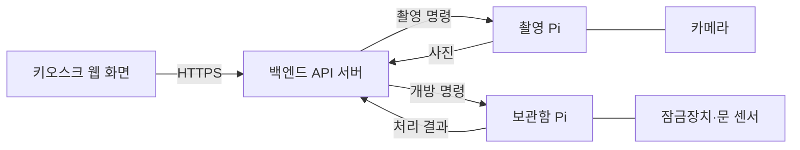

# smart-lost-found Raspberry Pi

키오스크 현장의 하드웨어를 제어하는 라즈베리파이 파트. 라즈베리파이 두 대를 쓴다. 촬영 Pi는 촬영 상자의 카메라와 키오스크 화면을, 보관함 Pi는 보관함의 잠금장치와 문 센서를 맡는다. 두 Pi 모두 백엔드의 명령을 받아 하드웨어를 움직이고, 결과를 백엔드에 돌려준다.

현재 두 Pi의 기본 설정과 카메라 첫 시험을 마쳤고, 백엔드 명령을 받는 Pi 컨트롤러 뼈대를 가짜 하드웨어 모드로 만들었다. 실제 장치와 백엔드 서버에 붙여 보는 것은 다음 단계다. 백엔드와 주고받는 요청·응답은 [docs/device-protocol.md](../docs/device-protocol.md)에 정리했다.

## 문서

| 문서 | 내용 |
| --- | --- |
| [통신 규약](../docs/device-protocol.md) | 백엔드와 두 Pi가 주고받는 API, 오류, 흐름 |
| [설치와 접속](deploy/setup.md) | 운영체제 설치, 카메라 연결, SSH 접속, 설치 확인 |
| [문제 해결 기록](docs/troubleshooting.md) | 막혔던 문제와 원인·해결 |
| [실험 0001](docs/experiments/0001-camera-first-test.md) | 카메라 초점·촬영 시간과 사진 크기 |
| [결정 기록 0001](docs/decisions/0001-single-camera-two-shots.md) | 카메라 1대로 물건 방향을 바꿔 2장 촬영 |

## 구성

| Pi | 연결 장치 | 하는 일 |
| --- | --- | --- |
| 촬영 Pi | 카메라 1대(Camera Module 3), 모니터, 키보드, 마우스 | 분실물 촬영(방향을 바꿔 2장), 키오스크 웹 화면 실행 |
| 보관함 Pi | 보관함 잠금장치 2개, 문 센서 2개 | 보관함 개방, 문 상태 확인 |

사진을 2장 찍는 이유: 물건의 한 면만 찍으면 모양·크기·특징을 정확히 판별하기 어렵다. Raspberry Pi 4에는 카메라 단자가 하나뿐이라, 카메라 1대로 한 장을 찍은 뒤 사용자에게 물건을 돌리거나 눕혀 달라고 안내하고 한 장을 더 찍는다.

Pi를 두 대로 나눈 이유: 촬영 상자 쪽에는 카메라와 모니터·키보드·마우스를, 보관함 쪽에는 잠금장치와 문 센서를 연결한다. 촬영 상자와 보관함의 위치에 따라 한 대로는 배선이 어려울 수 있어 두 대로 나눴다. 두 Pi는 같은 프로그램을 쓰고 설정으로 역할을 나눈다.

## 시스템에서의 위치



백엔드와 두 Pi는 Tailscale로 연결된다. 키오스크 웹 화면은 촬영 Pi에 연결한 모니터에 띄우지만, 화면은 Pi의 API를 직접 부르지 않고 백엔드하고만 통신한다. Pi도 백엔드를 주기적으로 조회하지 않는다.

## 하드웨어 구성 (시제품)

- 촬영 상자 1개: 카메라 1대(Raspberry Pi Camera Module 3, 자동초점). 분실물을 넣고 '촬영'을 누르면 한 장, 물건을 돌리거나 눕힌 뒤 한 장을 더 찍는다
- 보관함 2개: 칸마다 잠금장치와 문 센서
- 모니터·키보드·마우스: 키오스크 화면 표시와 입력 (터치 화면이 아니다)

부품과 배선은 확정되는 대로 `hardware/`에 정리한다.

## 폴더 구성

```text
raspberry-pi/
├── app/        Pi 컨트롤러 (FastAPI, 설정으로 촬영/보관함 역할 선택)
│   └── hardware/   장치 기능 정의와 가짜 장치 (실제 장치는 추가 예정)
├── tests/      통신 규약 테스트
├── deploy/     설치·접속 안내 (자동 실행 서비스, 키오스크 브라우저, Tailscale 설정은 추가 예정)
├── hardware/   부품 목록, 배선도, 3D 모델 (예정)
├── docs/       설계 결정, 실험, 문제 해결 기록
└── media/      사진, 시연 영상 (예정)
```

## 실행 방법 (개발용 가짜 하드웨어)

```bash
cd raspberry-pi
python3 -m venv .venv
source .venv/bin/activate
pip install -r requirements-dev.txt
cp .env.example .env    # PI_ROLE과 PI_API_KEY를 정한다
uvicorn --factory app.main:create_app --host 127.0.0.1 --port 8001
pytest -q               # 테스트
```

`PI_FAKE_HARDWARE=true`이면 실제 장치 없이 동작한다. 촬영 요청에는 번호와 시각이 적힌 샘플 JPEG를 돌려주고, 보관함을 열면 문이 `PI_FAKE_DOOR_OPEN_SECONDS`초 동안 열려 있다가 닫힌 것으로 보인다. 같은 `command_id`가 다시 오면 만료 여부와 상관없이 처음 결과를 돌려주고, 새 명령만 만료 시각을 검사한다.

## 백엔드 호출 코드로 확인

가짜 모드로 촬영 Pi와 보관함 Pi를 각각 띄운다(키는 예시).

```bash
PI_ROLE=capture PI_API_KEY=capture-key-123 PI_FAKE_HARDWARE=true uvicorn --factory app.main:create_app --port 8001
PI_ROLE=locker PI_API_KEY=locker-key-123 PI_FAKE_HARDWARE=true uvicorn --factory app.main:create_app --port 8002
```

2026-10-26 확인(2026-10-28 재확인): 백엔드가 Pi를 부를 때 쓰는 코드(`backend/app/integrations.py`의 `PiGateway`)로 두 서버를 불러 9가지를 확인했고 모두 기대한 결과가 나왔다. 확인한 것은 촬영 2회(백엔드 JPEG 검사 통과), 보관함 개방, 개방 직후와 잠시 뒤의 문 상태(open → closed), 오류 4가지(만료된 명령, 없는 보관함, 틀린 API 키, 촬영 주소에 보관함 Pi를 넣은 경우)이다.

백엔드 서버를 띄워 등록 흐름 전체를 돌려 본 것은 아니다. 백엔드 서버로 촬영·분석·개방까지 가려면 S3와 AI 연결이 필요하다([백엔드 README](../backend/README.md) 참고).

## 진행 현황

- [x] 시스템 설계 개요와 통신 구조 검토
- [x] Pi 2대 구성 결정 (촬영 Pi, 보관함 Pi)
- [x] 촬영 방식 결정 (카메라 1대로 물건 방향을 바꿔 2장 촬영)
- [x] 백엔드-Pi 통신 규약 초안 작성
- [x] Pi 2대 기본 설정 (Raspberry Pi OS trixie 64비트, SSH 공개키 접속)
- [x] 카메라 연결과 첫 시험 (초점·촬영 시간, 사진 크기)
- [ ] 통신 규약 확정 (백엔드와 협의)
- [ ] 하드웨어 부품 확정
- [x] Pi 컨트롤러 뼈대 (API, 인증·만료·중복 처리, 가짜 하드웨어 모드, 테스트)
- [ ] 실제 카메라 연결 (촬영 Pi)
- [ ] 실제 잠금장치·문 센서 연결 (보관함 Pi)
- [ ] 백엔드 서버·실제 Pi와 연동 시험
- [ ] 키오스크 화면 자동 실행과 고정 (브라우저 종료·주소 변경 방지)

## 진행 기록

| 날짜 | 내용 |
| --- | --- |
| 2026-10-03 | 시스템 설계 개요와 팀 통신 구조 검토, 백엔드-Pi 통신 규약 초안과 파트 README 작성 (#3) |
| 2026-10-05 | 키트 구성품 검증(Pi 4 4GB 2대, 센서·입출력 키트, Camera Module 3 2대), 위·옆 카메라 2대 구성 설계 (#4) |
| 2026-10-05~08 | Camera Module 3 연결 방식 조사: Pi 4는 카메라 단자가 1개이고 전환 보드는 Trixie에서 IMX708 미지원 확인 → 10/6 팀 회의에서 카메라 1대 2회 촬영으로 결정 (#5, 결정 기록 0001) |
| 2026-10-08 | 프론트 문서 리뷰로 촬영 상자 상시 개방, 웹→백엔드 단일 경로, 보관함 개방 후 번호 표시 순서를 맞춤 (#6), main 브랜치 강제 푸시·삭제 금지 설정 |
| 2026-10-12~13 | (팀) 백엔드 등록·촬영·보관 API 병합 (#8) — Pi 컨트롤러를 붙일 대상이 준비됨 |
| 2026-10-26 | 백엔드 Pi 호출 코드와 통신 규약 대조, 학교 SD 카드 점검 후 두 Pi에 Raspberry Pi OS(trixie 64비트) 새로 설치, 카메라 연결 문제 해결, 카메라 첫 시험 (실험 0001) |
| 2026-10-26~28 | Pi 컨트롤러 뼈대(가짜 하드웨어 모드)와 통신 규약 테스트 15개, 백엔드 Pi 호출 코드(`PiGateway`)로 응답 형식 확인 |
