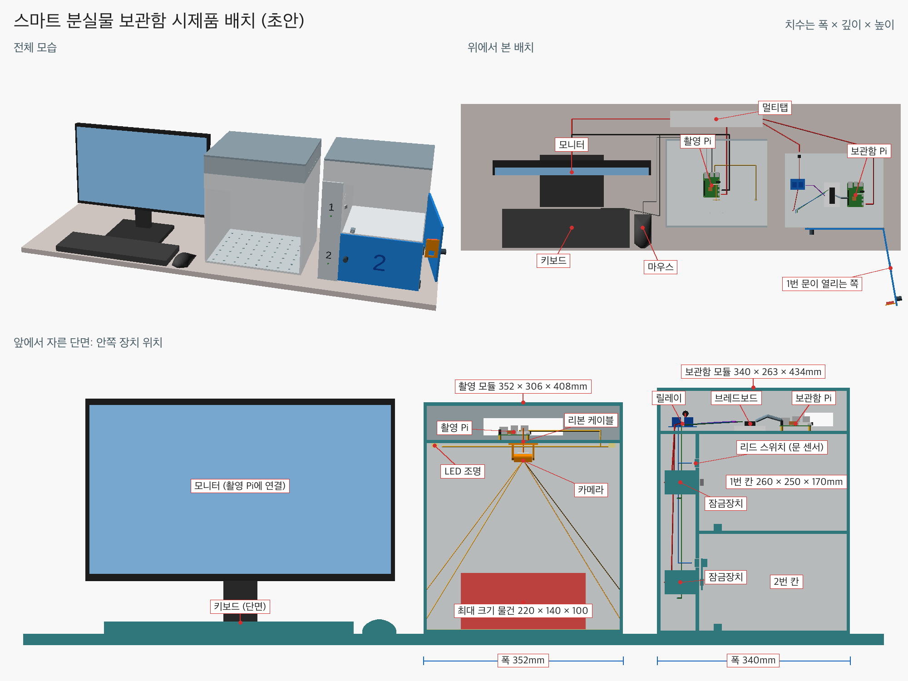
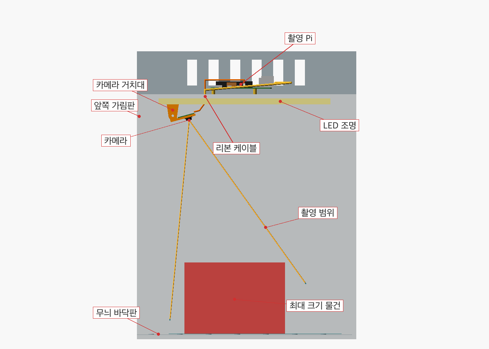
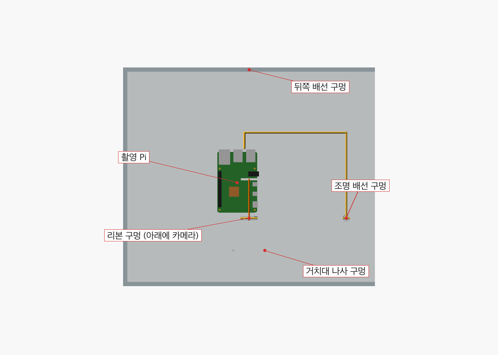
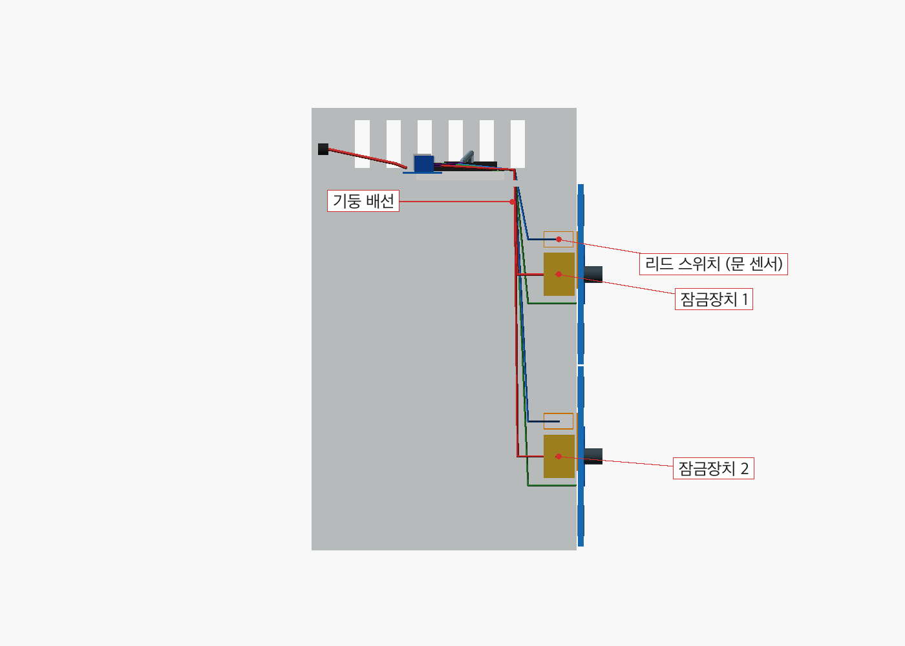
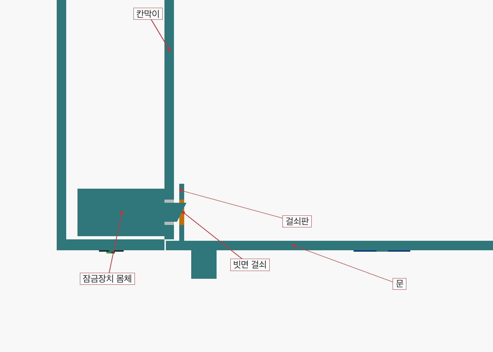
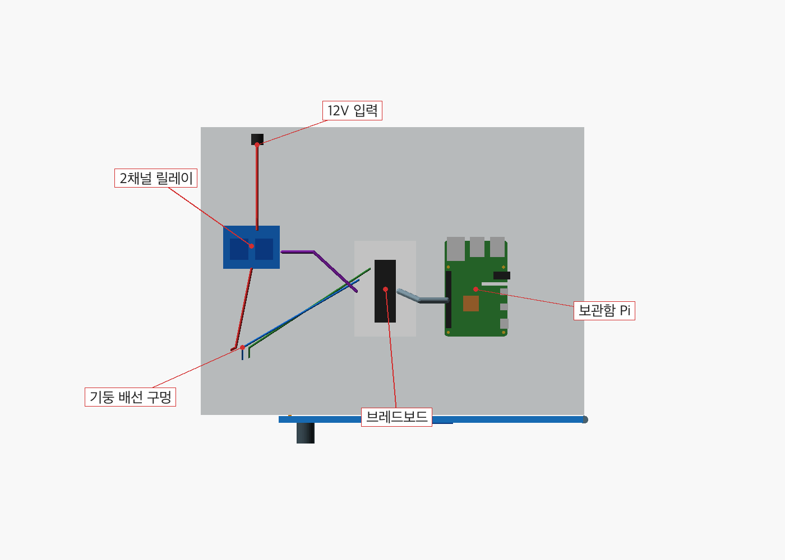
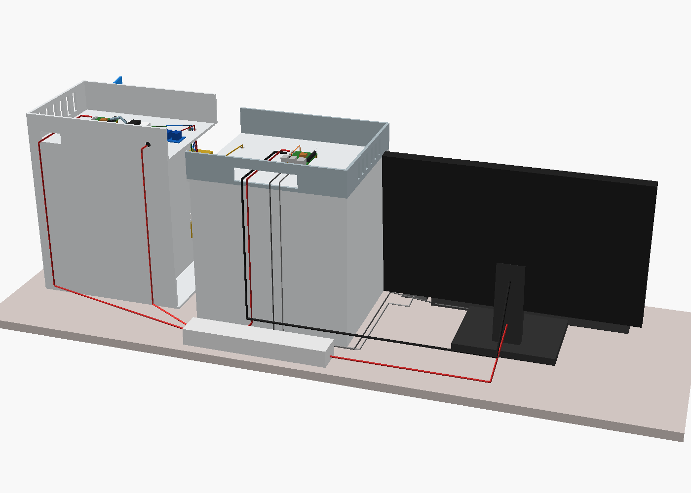

# 하드웨어 설계

촬영 모듈과 보관함 모듈의 3D 배치 모델이다. 실물을 만들기 전에 상자 크기, Pi와 카메라의 위치, 배선 경로를 정하려고 만들었다. 지금은 초안이고, 잠금장치를 사서 실측하면 치수를 고친다.

치수는 폭 × 깊이 × 높이 순서로 적는다. 왼쪽부터 모니터·키보드·마우스, 촬영 모듈, 보관함 모듈이다. 사용자는 화면을 보면서 물건을 촬영 상자에 넣고, 촬영이 끝나면 바로 오른쪽의 보관함으로 옮겨 넣는다. 두 모듈은 전원선만 있고 서로 이어지는 선은 없어서 따로 옮기거나 떨어뜨려 놓을 수 있다.

## 모델 보는 법

- GitHub에서 돌려 보기: [전체 배치](3d/stl/kiosk_all.stl), [속이 보이는 배치](3d/stl/kiosk_inside.stl), [촬영 모듈](3d/stl/capture_station.stl), [보관함 모듈](3d/stl/locker_cabinet.stl)을 열고 마우스로 끌면 돌아가고 스크롤하면 확대된다. 속이 보이는 배치는 뚜껑과 가까운 벽을 빼고 두 모듈을 벌려 놓은 것이다. STL에는 색이 없어서 장치 구분은 위 그림으로 본다.
- 치수 바꾸기: OpenSCAD로 [3d/kiosk.scad](3d/kiosk.scad)를 열고 Window > Customizer에서 값을 바꾼다. 콘솔에 점검 결과가 함께 찍힌다.
- STL과 그림 다시 만들기: `3d` 폴더에서 `python3 build.py`를 실행한다.

| 파일 | 내용 |
| --- | --- |
| `3d/kiosk.scad` | 치수와 전체 배치 (이 파일을 연다) |
| `3d/capture_station.scad` | 촬영 상자, 카메라 거치대, 촬영 Pi 칸 |
| `3d/locker_cabinet.scad` | 보관함, 문, 걸쇠판, 보관함 Pi 칸 |
| `3d/devices.scad` | Pi, 카메라, 잠금장치 같은 실제 장치 모양 |
| `3d/cables.scad` | 배선 경로와 주변 장비 |
| `3d/checks.scad` | 설계 점검 |
| `3d/stl/` | `camera_mount.stl`, `door_tab.stl`은 3D 프린터로 뽑을 부품이다 |
| `3d/renders/` | 설명 그림. `summary.png`가 한 장 요약이다 |

## 촬영 모듈

바깥 크기는 352 × 306 × 408mm, 상자 안쪽은 340 × 300 × 330mm이다.

- 카메라는 천장 아래 앞쪽에 달고 상자 뒤쪽으로 15도 기울였다. 물건을 비스듬히 위에서 찍기 위해서다. 거치대의 회전축 나사를 풀면 0~30도로 조절할 수 있다.
- 렌즈 높이는 바닥에서 299mm이다. [실험 0001](../docs/experiments/0001-camera-first-test.md)에서 약 17cm 거리는 초점이 맞는 깊이가 얕아서 더 높였다.
- 촬영 범위는 바닥에서 앞뒤 44~286mm, 폭 365~446mm이고, 높이 100mm 물건의 윗면에서는 앞뒤 54~215mm, 폭 243~297mm이다. 그래서 220 × 140 × 100mm 물건까지 한 장에 들어온다. 범위가 상자보다 넓어서 바닥 쪽 양옆에는 벽도 찍힌다.
- 바닥판에는 무늬를 넣는다. 실험 0001에서 무늬 없는 면은 초점이 느리거나 실패했다.
- 상자 벽은 불투명으로 두고 천장 양쪽에 LED 조명을 달았다. 주변 밝기와 반사의 영향을 줄이려는 것이다.
- 앞면은 항상 열려 있고 잠그지 않는다. 앞쪽 위 가림판은 카메라와 천장 배선을 가린다.

촬영 Pi는 천장 위 칸에서 리본 구멍 바로 뒤에 둔다. Pi 4의 카메라 단자는 HDMI 쪽 변에 직각으로 놓여 있어 리본이 보드의 긴 방향으로 나간다. 그래서 보드의 긴 변을 앞뒤로 놓았고, 이렇게 하면 리본이 꼬이지 않고 일직선으로 간다. USB는 뒤쪽, HDMI와 전원은 오른쪽을 보고, 선은 뒤쪽 구멍으로 나간다. 뚜껑을 열면 Pi에 손이 닿는다.

## 보관함 모듈

바깥 크기는 340 × 263 × 434mm, 칸 안쪽은 260 × 250 × 170mm이다. 위 칸이 1번, 아래 칸이 2번이다.

- 문의 경첩은 오른쪽에 있다. 왼쪽의 촬영 상자에서 물건을 옮길 때 열린 문이 길을 막지 않게 하기 위해서다.
- 왼쪽 기둥에 칸마다 솔레노이드 잠금장치를 둔다. 전기가 들어오는 동안만 풀리고 문을 닫으면 저절로 걸리는 방식이라, 통신 규약의 개방 명령 하나로 동작하고 잠그는 명령은 필요 없다.
- 잠금장치, 리드 스위치, LED 배선은 기둥을 타고 올라가 위쪽 Pi 칸으로 들어간다.
- 기둥 앞판에 칸 번호와 상태 LED를 둔다. 문을 덮지 않는 자리라 움직이는 배선이 없다.

위에서 내려다본 잠금 구조 단면이다.

- 문 뒤에 붙은 걸쇠판이 칸막이 옆으로 들어가고, 문을 닫으면 빗면 걸쇠가 밀렸다가 걸쇠판의 창에 걸린다.
- 문은 경첩을 중심으로 호를 그리며 닫혀서 걸쇠판 끝이 칸막이 쪽으로 최대 2.9mm 파고든다. 그래서 칸막이와 걸쇠판을 3.5mm 띄웠다.
- 리드 스위치는 칸막이에 낸 구멍에 넣고 자석은 걸쇠판에 붙인다. 문이 닫히면 둘의 간격이 6.5mm가 된다.
- 칸 앞쪽 왼쪽 아래의 스프링이 문을 살짝 밀어 준다. 잠금장치에 전기를 잠깐만 넣기 때문에, 이 스프링이 없으면 사용자가 문을 당기기 전에 다시 잠길 수 있다.

위쪽 칸에 보관함 Pi, 키트의 브레드보드, 2채널 릴레이를 둔다. 12V 전원은 뒤판의 단자로 들어와 릴레이로 간다.

## 배선

| 연결 | 케이블 | 모델 기준 길이 |
| --- | --- | --- |
| 카메라 → 촬영 Pi 카메라 단자 | 리본 케이블 | 123mm 이상 |
| 촬영 Pi → 모니터 | micro HDMI to HDMI | 약 1.25m |
| 촬영 Pi → 키보드, 마우스 | USB | 약 1.15m, 1m |
| 촬영 Pi USB → LED 조명 | USB 5V | 칸 안에서 약 0.6m |
| 멀티탭 → 두 Pi | 5V 3A USB-C 어댑터 | 키트 기본 |
| 멀티탭 → 보관함 12V 단자 | 12V 어댑터 | 구매 필요 |

보관함 Pi 핀 배정안이다. 실제 구현 때 확정한다.

| 장치 | GPIO | 핀 번호 |
| --- | --- | --- |
| 릴레이 1 (1번 잠금장치) | 17 | 11 |
| 릴레이 2 (2번 잠금장치) | 27 | 13 |
| 리드 스위치 1 | 22 | 15 |
| 리드 스위치 2 | 23 | 16 |
| 상태 LED 1 | 24 | 18 |
| 상태 LED 2 | 25 | 22 |

구매할 때 릴레이 모듈이 Pi의 3.3V 신호로 동작하는지 확인한다. 솔레노이드에는 역전압을 막는 다이오드를 달고, 뜨거워지므로 전기는 짧게만 넣는다.

## 설계 점검

모델로 확인한 내용이다. 실물로 확인한 것은 아니다.

| 항목 | 결과 |
| --- | --- |
| 카메라 거치대 기울기 0~30도 | 거치대, 카메라, 천장이 겹치지 않음 |
| 문 열림 0~110도 | 문, 걸쇠판, 보관함이 겹치지 않음 |
| 문을 닫아 잠긴 상태 | 걸쇠가 걸쇠판 창을 지나고 겹치지 않음, 걸쇠판이 받치는 폭 10mm |
| 리본 케이블 | 150mm면 충분 (필요 길이 123mm) |
| 최대 크기 물건 | 촬영 범위와 보관함 칸에 모두 들어감 |
| 책상 폭 | 24인치 모니터 기준 약 1.44m 필요 |

걸쇠 길이는 몸체 밖으로 14mm라고 가정했고, 이때 걸쇠는 걸쇠판을 지나 1.5mm 더 나온다. 판매처마다 표기가 달라서 이 값이 가장 불확실하다. 실제 걸쇠가 10mm면 걸쇠판에 0.5mm만 걸려 잠기지 않으므로, 그때는 칸막이 구멍을 넓혀 잠금장치를 6mm 더 밀어 넣는다.

## 아직 정할 것

- 제작 재료와 방법: 패널 두께 6mm로 가정했다. 3D 프린터가 있으면 거치대와 걸쇠판만 뽑고, 큰 패널은 판재로 만드는 안이다.
- 모니터 크기와 위치: 24인치로 가정했다.
- 리본 케이블 길이: 150mm로 가정했다.
- 받을 물건의 최대 크기: 220 × 140 × 100mm로 가정했다. 노트북이나 가방처럼 큰 물건은 이 시제품에 들어가지 않는다.
- 촬영 상자 벽: 불투명과 LED로 그렸고, 투명 벽과 비교가 필요하다.
- 잠금장치와 문 센서 제품: 구매 후 실측해서 치수를 고친다.

## 치수 출처

| 장치 | 치수 | 출처 |
| --- | --- | --- |
| Raspberry Pi 4 | 85 × 56mm, 구멍 58 × 49mm | [공식 기계 도면](https://datasheets.raspberrypi.com/rpi4/raspberry-pi-4-mechanical-drawing.pdf) |
| Camera Module 3 | 25 × 23.86mm, 구멍 21 × 12.5mm | [공식 기계 도면](https://datasheets.raspberrypi.com/camera/camera-module-3-standard-mechanical-drawing.pdf) |
| 카메라 화각 | 가로 66도, 세로 41도 | [공식 문서](https://www.raspberrypi.com/documentation/accessories/camera.html) |
| 솔레노이드 잠금장치 | 55 × 42 × 30mm | 판매처 표기, 구매 후 실측 |
| 리드 스위치 | 27 × 14 × 8mm, 작동 거리 약 14mm 이상 | 판매처 표기, 구매 후 실측 |
| 2채널 릴레이 | 50 × 38 × 19mm | 판매처 표기, 구매 후 실측 |
